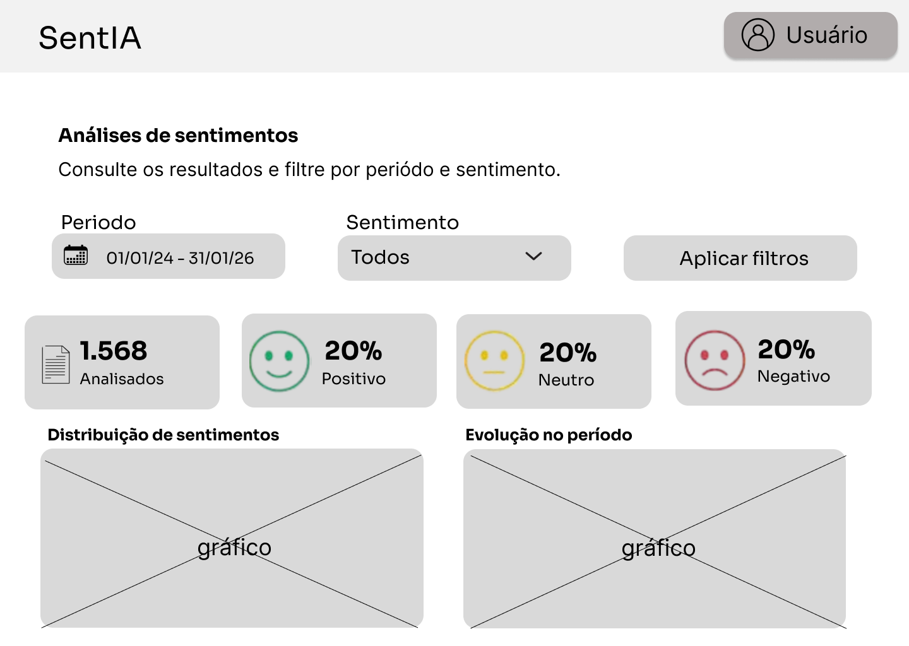

# SentIA — Wireframes de baixa fidelidade

## Sobre esta entrega

Este material apresenta a proposta inicial de interface do SentIA,
com foco na organização do dashboard e na consulta dos resultados
da análise de sentimentos.

Nesta entrega, o wireframe do dashboard foi atualizado.
As demais telas e os fluxos completos serão desenvolvidos
em entregas posteriores.

Os arquivos representam uma proposta visual, não uma aplicação
implementada ou integrada a dados reais.

## Dashboard

A proposta do dashboard é permitir a consulta das análises
por meio de filtros, indicadores, distribuição dos sentimentos
e resumo dos resultados.

2026.2-T03-Liskov/
├── README.md
└── PAGES/
    └── Dashboard.png

[Ver a imagem do dashboard](./PAGES/Dashboard-1.png)

### Pontos para revisão

- Clareza dos nomes dos campos, indicadores e ações.
- Organização dos filtros de período e sentimento.
- Hierarquia entre indicadores, gráfico, resultados e resumo.
- Legibilidade e distribuição dos elementos no layout desktop.

## Figma

Link do arquivo de design:https://www.figma.com/design/AN2ZLwqkN4mi59YSXqEquw/Prototipo_SentIA-BF?node-id=0-1&t=MKknvGSP6P7wHefs-1.

Link do protótipo navegável:https://www.figma.com/proto/AN2ZLwqkN4mi59YSXqEquw/Prototipo_SentIA-BF?node-id=2011-415&t=5ysMyZpiMAbMoxQ5-0&scaling=contain&content-scaling=fixed&page-id=0%3A1&starting-point-node-id=2011%3A415&show-proto-sidebar=1.

## Próximas etapas

A continuidade do trabalho contempla a área administrativa,
a consulta detalhada das análises, os estados de interface
e a conexão dos fluxos de Usuário e Administrador.

## Observações

O material permanece em baixa fidelidade. Cores, tipografia,
ícones e acabamentos não representam a identidade visual definitiva.

Os valores apresentados têm finalidade demonstrativa.

Novas versões serão incorporadas conforme a evolução do trabalho.

________________________________________________________________________________________________

# template-repository - Branch Developer

Template de Repositório para a matéria de Métodos de Desenvolvimento de Software lecionado pelo professor Ricardo Ajax.

Essa Branch deve ser usada exclusivamente para a versão de desenvolvimento do software antes de ir para produção.

## Especificações Técnicas do Repositório

Este repositório é planejado e estruturado para que seja realizado documentações de software. Caso haja outra necessidades, deve-se consultar a professora.

Atualmente se usa a ferramenta MkDocs para gerar sua documentação baseado nos seus arquivos markdowns, vocês podem achar mais instruções sobre o MkDocs através do link da documentação da ferramenta: [https://www.mkdocs.org/](https://www.mkdocs.org/).

Também é usado uma "sub-ferramenta" do MkDocs para sua estilização, o Material Theme, que pode ser consultado através do link: [https://squidfunk.github.io/mkdocs-material/](https://squidfunk.github.io/mkdocs-material/).

Este repositório também conta com uma pipeline de automatização de deploy do seu conteúdo MkDocs, para que a cada commit feito na main, a pipeline gere uma versão atualizada da sua documentação em minutos. Vale ressaltar que é importante realizar uma configuração para que tudo funcione da forma correta, as instruções são as seguintes:

* Acesse as configurações do repositório;
* Procure a aba de "Pages"
* Em "Source" escolha a opção "Deploy from a branch";
* Em "Branch" escolha "gh-pages";
* Clique em salvar e pronto;

Após essas etapas de configuração, o seu GitPages deve funcionar normalmente.
