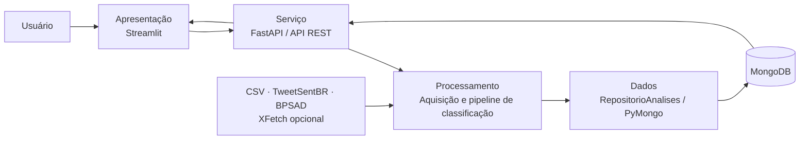

# SentIA — Análise de Sentimentos

Plataforma web acadêmica para análise de sentimentos em textos em português. O **SentIA** busca apoiar a interpretação de grandes volumes de publicações sobre temas, pessoas, produtos ou acontecimentos, classificando os textos como **positivos, negativos ou neutros** e disponibilizando os resultados para consulta.

**Projeto:** Grupo Liskov — Turma 03 · Métodos de Desenvolvimento de Software (MDS) · Universidade de Brasília (UnB/FGA) · 2026.2  
**Repositório:** [FGA0138-MDS-Ajax/2026.2-T03-Liskov](https://github.com/FGA0138-MDS-Ajax/2026.2-T03-Liskov)  
**Linha de base descrita:** branch `developer`, commit `1723a7d` (13/11/2026); status documental consultado até 14/11/2026.

> O SentIA é um projeto acadêmico em evolução. As classificações são previsões de um modelo e dependem da qualidade, do domínio e da representatividade dos dados. Resultados de amostras não devem ser generalizados para toda a população.

---

## Demonstração

Não foram encontrados screenshots ou vídeos que comprovem a aparência da versão atual na branch `developer`. Os arquivos de imagem atualmente versionados para o painel são **wireframes de referência**, não capturas da aplicação em execução:

- [Wireframe — visão geral](docs/frontend/wireframes/dashboard-visao-geral.png)
- [Wireframe — calendário](docs/frontend/wireframes/dashboard-calendario.png)
- [Wireframe — filtro por sentimento](docs/frontend/wireframes/dashboard-filtro-sentimento.png)
- [Wireframe — menu lateral](docs/frontend/wireframes/dashboard-menu-lateral.png)

Uma captura real ou vídeo deve ser adicionado aqui quando houver material atualizado da aplicação, sem substituir os wireframes por imagens fictícias.

## Funcionalidades e estado de implementação

| Área | Situação na `developer` |
|---|---|
| Importação de datasets CSV | Implementada, com validação do esquema e relatório de registros descartados. |
| Aquisição de dados | Adaptadores para TweetSentBR e BPSAD, além de coleta paginada via XFetch. A coleta externa depende de chave de API e pode ter custo. |
| Processamento textual | O fluxo do BERTweet preserva o texto original e utiliza o processamento do PySentimiento. O baseline comparativo aplica limpeza mínima antes de TF-IDF. |
| Classificação | Implementada com `pysentimiento/bertweet-pt-sentiment`, produzindo classes positivo, negativo e neutro. Há também um baseline separado de TF-IDF + Regressão Logística para comparação. |
| Persistência | Implementada com MongoDB, incluindo consultas, índices e deduplicação dos registros. |
| API REST | Rotas de saúde, processamento, consulta, resumo e administração implementadas em FastAPI. |
| Consulta e filtragem | API com paginação e filtros por período e sentimento. |
| Administração | Login, importação de CSV, pesquisa de assunto e acompanhamento de coletas disponíveis no painel. |
| Dashboard | Filtros de período/sentimento e indicadores numéricos disponíveis. A listagem paginada, os gráficos de distribuição e o resumo textual ainda estão pendentes. A nuvem de palavras é opcional e também não está implementada. |

### Pesquisa híbrida — recurso experimental

A pesquisa por assunto consulta primeiro a base persistida no MongoDB e pode complementar os resultados com o XFetch. A busca local é lexical; não utiliza embeddings nem MongoDB Vector Search. O recurso está integrado ao backend, mas ainda depende de ratificação formal da Product Owner, definição de limite financeiro para o XFetch e acompanhamento por issue específica. Não trate essa funcionalidade como uma integração sem custo ou como uma decisão de produto já homologada.

### Modos de execução

- **`mock`:** demonstração do painel com 17 análises fictícias e administração simulada. Não exige MongoDB nem chave XFetch. As credenciais `admin` / `senha-de-exemplo` pertencem exclusivamente ao mock e não são credenciais reais.
- **`api`:** conecta o Streamlit à API FastAPI. As rotas de dados e administração dependem do backend e de uma instância MongoDB acessível. A inferência BERTweet real também exige o grupo opcional de dependências `ml`.

## Arquitetura

A arquitetura implementada é organizada em quatro camadas. A interface conversa com o backend pela API REST; não acessa o MongoDB nem executa diretamente as regras de processamento.



| Camada | Responsabilidade | Código principal |
|---|---|---|
| Apresentação | Dashboard, filtros, login e administração. | `src/apresentacao/` |
| Serviço | Endpoints REST, validação, autenticação e coordenação dos fluxos. | `src/servico/` |
| Processamento | Aquisição, pipeline e classificação de sentimentos. | `src/processamento/` |
| Dados | Conexão, índices, consultas e persistência no MongoDB. | `src/dados/` |

### Fluxo de dados

1. Os textos são obtidos por importação CSV, adaptadores de datasets ou fontes de coleta disponíveis.
2. Os registros são normalizados e encaminhados ao pipeline de classificação.
3. O classificador gera a previsão de sentimento e as probabilidades correspondentes, preservando o texto original.
4. O backend persiste os registros e análises no MongoDB.
5. O painel consulta a API para apresentar indicadores, filtros e funcionalidades administrativas disponíveis.

O classificador BERTweet utiliza um checkpoint pré-treinado. O repositório não demonstra treinamento próprio do Transformer. O baseline TF-IDF + Regressão Logística é um comparador isolado, não uma substituição do BERTweet.

Detalhes: [Arquitetura atualizada — rascunho de revisão](docs/revisao-academica/ARQUITETURA_ATUALIZADA_RASCUNHO.md) · [Contrato único de dados](docs/contratos-dados.md) · [Contrato API ↔ Painel](docs/frontend/CONTRATO-API.md).

## Tecnologias

| Responsabilidade | Tecnologias |
|---|---|
| Linguagem e ambiente | Python 3.11, `uv` |
| Interface | Streamlit |
| API | FastAPI, Uvicorn |
| Banco de dados | MongoDB, PyMongo |
| Classificação principal | PySentimiento, BERTweet e PyTorch (dependências opcionais do grupo `ml`) |
| Baseline e experimentos | scikit-learn, TF-IDF e Regressão Logística |
| Dados e utilitários | pandas, requests, python-dotenv e joblib; NLTK também consta nas dependências declaradas do projeto |
| Qualidade | pytest, pytest-cov e Ruff |
| Integração contínua | GitHub Actions; a CI provisiona MongoDB `mongo:7` para os testes de persistência |
| Portal de documentação | MkDocs Material na branch separada `docs` (a configuração `mkdocs.yml` não está na branch `developer`) |

As versões são controladas por `pyproject.toml` e `uv.lock`. O PySentimiento e o PyTorch são instalados separadamente para permitir que a demonstração básica não precise baixar o modelo e suas dependências pesadas.

## Instalação e execução

### Pré-requisitos

- Git.
- Python 3.11 (versão indicada em `.python-version`).
- [`uv`](https://docs.astral.sh/uv/getting-started/installation/).
- MongoDB local ou remoto para executar os fluxos reais de persistência e consulta.

### 1. Clonar e preparar o ambiente

Execute na raiz do repositório:

```powershell
git clone https://github.com/FGA0138-MDS-Ajax/2026.2-T03-Liskov.git
cd 2026.2-T03-Liskov
uv sync --locked

# Cria o arquivo local sem sobrescrever um .env existente.
if (-not (Test-Path .env)) {
    Copy-Item .env.example .env
}
```

O arquivo `.env.example` contém os nomes das variáveis reconhecidas. Edite a cópia local `.env` de acordo com o modo de execução. Não versione esse arquivo e não coloque nele credenciais reais em exemplos ou commits.

Para instalar também as dependências do BERTweet real:

```powershell
uv sync --locked --group ml
```

Esse grupo instala `pysentimiento` e `torch` e pode exigir um download considerável na primeira execução. Sem ele, os testes e fluxos que usam um classificador simulado continuam disponíveis, mas a inferência BERTweet real não.

### Configuração do dispositivo de inferência

O dispositivo utilizado pelo BERTweet é configurado por meio das seguintes variáveis de ambiente:

| Variável | Descrição |
|---|---|
| `SENTIA_DISPOSITIVO` | Aceita `cpu`, `cuda` ou `auto`. O padrão é `cpu`. |
| `SENTIA_GPU_INDEX` | Índice físico da GPU utilizada. O padrão é `0`. |

Se o runtime da GPU já tiver sido inicializado antes da seleção de uma GPU física diferente do índice zero, será necessário reiniciar o processo. Nesse cenário, o modo auto utiliza a CPU; o modo cuda informa o erro.

Os modos de execução são:

- `cpu`: executa a inferência no processador, utilizando precisão FP32.
- `cuda`: exige uma GPU compatível e gera erro se ela não estiver disponível. Na GPU, o modelo utiliza precisão FP16.
- `auto`: utiliza a GPU quando disponível e, caso contrário, utiliza a CPU.

Em máquinas com múltiplas GPUs, `SENTIA_GPU_INDEX` permite selecionar a placa desejada. Mesmo quando uma GPU física diferente da primeira é selecionada, o dispositivo pode aparecer internamente como `cuda:0`, devido ao isolamento feito pelo PyTorch.

Se ocorrer falta de memória da GPU (OOM) durante a inferência de um lote, o classificador tenta novamente o lote afetado na CPU e continua a inferência nesse dispositivo.

Exemplo de configuração no `.env`:

```dotenv
SENTIA_DISPOSITIVO=cuda
SENTIA_GPU_INDEX=1
```

Para executar sem GPU, utilize `SENTIA_DISPOSITIVO=cpu`. A configuração auto permite selecionar automaticamente entre GPU e CPU.

A disponibilidade de GPU depende da instalação de uma versão do PyTorch compatível com o hardware e os respectivos drivers. A instalação do grupo ML, isoladamente, não garante suporte a GPU.

### 2. Configurar o MongoDB

Inicie uma instância MongoDB e configure `MONGODB_URI` no `.env`. Para uma instância local com a configuração padrão do exemplo:

```dotenv
MONGODB_URI=mongodb://localhost:27017/sentia
```

A branch `developer` não fornece um `docker-compose.yml`; a instância MongoDB deve estar disponível separadamente. A demonstração `mock` do painel não depende do banco. Já as rotas de análise, datasets, pesquisa persistente e coleta precisam da conexão configurada.

### 3. Executar somente o painel em modo demonstração

```powershell
$env:SENTIA_FONTE_DADOS = "mock"
$env:SENTIA_MOCK_CENARIO = "normal"
uv run streamlit run src/apresentacao/app.py
```

Acesse [http://localhost:8501](http://localhost:8501). Os cenários de mock aceitos são `normal`, `vazio` e `erro`.

### 4. Configurar e iniciar a API

Para habilitar a área administrativa, configure no `.env`:

```dotenv
SENTIA_ADMIN_USUARIO=seu_usuario
SENTIA_ADMIN_SENHA_HASH=
SENTIA_SESSAO_MINUTOS=60
```

Gere o hash da senha com o comando abaixo. A senha é solicitada no terminal e não deve ser colocada diretamente no repositório:

```powershell
uv run python -m src.servico.autenticacao
```

Copie o valor impresso em `SENTIA_ADMIN_SENHA_HASH` para o `.env`. Em seguida, inicie a API em um terminal:

```powershell
uv run uvicorn src.servico.main:app --host 127.0.0.1 --port 8000 --reload
```

Verifique a saúde em [http://127.0.0.1:8000/health](http://127.0.0.1:8000/health). A documentação interativa da API fica em [http://127.0.0.1:8000/docs](http://127.0.0.1:8000/docs).

### 5. Conectar o painel à API

Em outro terminal PowerShell:

```powershell
$env:SENTIA_FONTE_DADOS = "api"
$env:SENTIA_API_URL = "http://127.0.0.1:8000"
uv run streamlit run src/apresentacao/app.py
```

Acesse [http://localhost:8501](http://localhost:8501). Para o painel consultar e administrar dados reais, mantenha a API e o MongoDB disponíveis.

### Variáveis de ambiente principais

| Variável | Finalidade |
|---|---|
| `SENTIA_FONTE_DADOS` | `mock` ou `api`; seleciona a origem de dados do painel. |
| `SENTIA_MOCK_CENARIO` | `normal`, `vazio` ou `erro`; controla os cenários de demonstração. |
| `SENTIA_API_URL` | Endereço-base da API consumida pelo painel. |
| `SENTIA_API_TIMEOUT_SEGUNDOS` | Tempo limite das chamadas do painel à API. |
| `MONGODB_URI` | URI de conexão com o MongoDB. |
| `SENTIA_ADMIN_USUARIO` | Usuário da administração da API. |
| `SENTIA_ADMIN_SENHA_HASH` | Hash scrypt da senha administrativa; não armazenar a senha em texto puro. |
| `SENTIA_SESSAO_MINUTOS` | Duração das sessões administrativas. |
| `SENTIA_LIMITE_CSV_MB` | Limite de tamanho dos arquivos CSV enviados. |
| `SENTIA_LIMITE_COLETA` | Limite de textos por coleta. |
| `SENTIA_DISPOSITIVO` | `cpu`, `cuda` ou `auto`; define o dispositivo de inferência do BERTweet. Padrão: `cpu`. |
| `SENTIA_GPU_INDEX` | Índice físico da GPU selecionada para a inferência do BERTweet. Padrão: `0`. |
| `XFETCH_API_KEY` | Chave opcional do serviço externo XFetch; pode envolver cobrança. |

A lista completa e os valores de exemplo estão em [`.env.example`](.env.example).

## API REST

A API é implementada em `src/servico/`. As rotas principais disponíveis na linha de base são:

| Método | Endpoint | Finalidade |
|---|---|---|
| `GET` | `/health` | Verifica se o serviço responde. |
| `POST` | `/analises` | Classifica e persiste um lote de registros. |
| `GET` | `/analises` | Consulta análises com paginação e filtros. |
| `GET` | `/analises/resumo` | Retorna indicadores agregados conforme os filtros. |
| `POST` | `/auth/login` | Inicia sessão administrativa. |
| `POST` | `/auth/logout` | Encerra sessão administrativa. |
| `POST` | `/datasets` | Recebe um dataset CSV. |
| `GET` | `/coletas/fontes` | Lista fontes de coleta disponíveis. |
| `POST` | `/coletas` | Solicita uma coleta e seu processamento. |
| `GET` | `/coletas/{id_coleta}` | Consulta o estado de uma coleta. |

Os filtros de consulta incluem período (`inicio` e `fim`) e sentimento (`positivo`, `negativo` ou `neutro`); a listagem também aceita `pagina` e `tamanho`. Os parâmetros, esquemas JSON, exemplos e códigos de resposta estão no [Contrato API ↔ Painel](docs/frontend/CONTRATO-API.md) e na especificação interativa `/docs`.

**Nota de acesso:** as rotas `/analises` e `/analises/resumo` não exigem login administrativo na implementação descrita. As rotas administrativas utilizam autenticação por token. Antes de disponibilizar a API publicamente, as decisões de autorização e publicação ainda precisam ser tratadas.

## Testes e qualidade

Na raiz do projeto, execute:

```powershell
# Suíte completa com cobertura
uv run pytest --cov=src -q

# Verificações Ruff usadas no projeto
uv run ruff check src/apresentacao tests/test_painel_*.py
uv run ruff check --isolated --select F,E9 .

# Confere o lockfile
uv lock --check
```

A CI executa as verificações de lint, dependências e testes; o workflow provisiona MongoDB `mongo:7` para os testes reais de persistência. Localmente, testes que exigem MongoDB podem ser ignorados quando `MONGODB_URI_TESTE` não estiver acessível. Os testes de inferência BERTweet e de integração XFetch usam dublês/mocks na suíte automatizada; isso não equivale a uma avaliação real do modelo nem a uma coleta externa.

- [Plano de testes atual](docs/qa/inspecao/PLANO_TESTES_ATUAL.md)
- [Matriz de rastreabilidade T01–T18](docs/qa/inspecao/MATRIZ_RASTREABILIDADE.md)
- [Relatório de execução da linha de base](docs/qa/inspecao/RELATORIO_EXECUCAO.md)
- [Registro de defeitos e correções](docs/qa/inspecao/DEFEITOS_E_CORRECOES.md)

A métrica negocial do plano GQM é a acurácia da classificação. As métricas de projeto incluem velocidade por Sprint e burndown. Cobertura de testes, lint e quantidade de testes são indicadores de qualidade de software e **não** devem ser apresentados como métricas GQM de desempenho do modelo ou produtividade. Consulte [Plano GQM vigente](docs/metricas/PLANO_GQM_VIGENTE.md) e [Registro e análise](docs/metricas/REGISTRO_E_ANALISE.md); as decisões de critérios e limiares continuam sujeitas à PO.

## Estrutura do repositório

```text
.
├── .github/workflows/   # Integração contínua
├── Datasets/            # Datasets versionados e dados de demonstração
├── docs/                # Documentação técnica, acadêmica, QA e gestão
├── scripts/             # Scripts de demonstração, auditoria e experimentos
├── src/
│   ├── apresentacao/    # Painel Streamlit
│   ├── servico/         # API FastAPI, autenticação e administração
│   ├── processamento/  # Aquisição, pipeline e classificação
│   └── dados/           # Conexão e repositório MongoDB
├── tests/               # Testes automatizados e fixtures
├── .env.example         # Modelo de configuração local
├── Makefile             # Atalhos de desenvolvimento
├── pyproject.toml       # Dependências e ferramentas
├── uv.lock              # Versões resolvidas
└── README.md             # Porta de entrada do projeto
```

## Documentação, desenvolvimento e contribuição

O [índice de documentação](docs/README.md) organiza os materiais disponíveis na branch `developer`. Comece por estes documentos:

| Assunto | Documento |
|---|---|
| Arquitetura atual | [Arquitetura atualizada — rascunho de revisão](docs/revisao-academica/ARQUITETURA_ATUALIZADA_RASCUNHO.md) |
| Visão do Produto e Projeto | [Visão atualizada — rascunho de revisão](docs/revisao-academica/VISAO_ATUALIZADA_RASCUNHO.md) |
| Contratos e dados | [Contrato único de dados](docs/contratos-dados.md) · [Esquema MongoDB](docs/banco/esquema-mongodb.md) |
| Instalação e banco | [Este README](#instalação-e-execução) · [Configuração MongoDB](docs/mongodb_setup.md) |
| Desenvolvimento do painel | [Guia do frontend](docs/frontend/README.md) · [Wireframes e estado dos componentes](docs/frontend/WIREFRAMES.md) |
| API | [Contrato API ↔ Painel](docs/frontend/CONTRATO-API.md) |
| Testes | [README da suíte](tests/README.md) · [Plano de testes](docs/qa/inspecao/PLANO_TESTES_ATUAL.md) |
| Métricas GQM | [Plano GQM vigente](docs/metricas/PLANO_GQM_VIGENTE.md) · [Registro e análise](docs/metricas/REGISTRO_E_ANALISE.md) |
| Configuração e fluxo de trabalho | [Gestão de configuração](docs/gestao/GESTAO_CONFIGURACAO.md) · [Planejamento e Sprints](docs/gestao/PLANEJAMENTO_E_REPLANEJAMENTOS.md) |
| Aquisição e classificação | [TweetSentBR](docs/tweetsentbr.md) · [BPSAD](docs/bpsad.md) · [XFetch](docs/integracao_xfetch.md) · [Classificação](docs/classificacao.md) |
| Histórico de alterações | [CHANGELOG](CHANGELOG.md) |

### Portal MkDocs

A configuração `mkdocs.yml` e a página inicial do portal estão na branch separada [`docs`](https://github.com/FGA0138-MDS-Ajax/2026.2-T03-Liskov/tree/docs), não na linha de base `developer` descrita aqui. O PR [#93 — Portal MkDocs](https://github.com/FGA0138-MDS-Ajax/2026.2-T03-Liskov/pull/93) foi integrado à branch `docs`. O código-fonte do portal pode ser consultado nessa branch; este README não assume que a configuração MkDocs já esteja incorporada em `developer`.

### Documentos acadêmicos

Os arquivos Markdown de Visão e Arquitetura listados acima são **rascunhos de revisão**. Eles ajudam a localizar divergências entre documentação e implementação, mas não substituem os documentos acadêmicos formais aprovados. Diferenças ainda não resolvidas devem permanecer registradas, sem alterar silenciosamente os artefatos acadêmicos para esconder divergências.

### Equipe

Projeto desenvolvido pelo **Grupo Liskov — Turma 03**, na disciplina de MDS da UnB/FGA. A documentação de planejamento identifica as frentes de produto, coordenação/qualidade, aquisição, machine learning, dados e interface. O mapeamento nominal completo das oito pessoas ainda aparece como sujeito a reconciliação nos documentos de revisão; por isso, este README não atribui nomes ou responsabilidades individuais que não estejam consolidados. Consulte o [rascunho do Documento de Visão](docs/revisao-academica/VISAO_ATUALIZADA_RASCUNHO.md) para o registro e suas ressalvas.

## Contribuição

1. Atualize sua branch local a partir de `developer`.
2. Crie uma branch de trabalho específica para a alteração (`feat/...`, `fix/...`, `docs/...` ou equivalente).
3. Mantenha a mudança dentro do escopo da issue e evite misturar refatorações sem relação com a tarefa.
4. Atualize testes e documentação quando o comportamento ou o uso mudar.
5. Execute as verificações relevantes e revise `git diff` antes de abrir um Pull Request para `developer`.

O critério de pronto documentado inclui testes aprovados, CI sem falhas, revisão por pares no PR, validação dos critérios de aceitação pela PO e documentação atualizada quando aplicável. As orientações detalhadas de branches, histórico e configuração estão em [Gestão de Configuração](docs/gestao/GESTAO_CONFIGURACAO.md). Não há um `CONTRIBUTING.md` separado na branch `developer` consultada.

---

**Estado do projeto:** Sprint 5 em andamento no corte documental de 14/11/2026. Entre as pendências registradas estão a reprodução da avaliação BPSAD por classe e sua deliberação pela PO, a ampliação das visualizações do dashboard, a validação integrada/visual, o teste de usabilidade e a publicação web. Consulte o [índice de documentação](docs/README.md) e o [planejamento por Sprint](docs/gestao/PLANEJAMENTO_E_REPLANEJAMENTOS.md) para os detalhes e atualizações.
