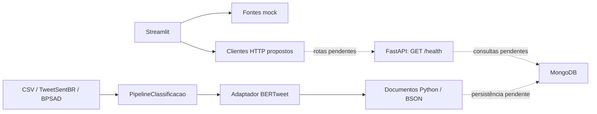

# Arquitetura observada no PC1

Referência: 09/11/2026, integração `bfaf7da`. Este é um retrato técnico do código;
não substitui o Documento de Arquitetura acadêmico, ainda indisponível.

| Responsabilidade | Código | Validação / limite |
|---|---|---|
| Entrada, navegação e sessão | `src/apresentacao/app.py`, `paginas/administracao.py` | AppTest; sessão local de exemplo |
| Fontes e contratos da apresentação | `src/apresentacao/contrato.py`, `fontes/` | Mock e HTTP simulado; API não fornece as rotas |
| Serviço | `src/servico/main.py` | `/health` e OpenAPI; sem orquestração |
| Aquisição | `src/processamento/aquisicao/` | Importadores locais, validação e auditoria |
| Pipeline | `src/processamento/pipeline.py` | Preserva identidade/texto, acrescenta previsão e datas UTC |
| Modelo | `src/processamento/classificacao/bertweet.py` | Analisador injetável; ML real opcional |
| Baseline | `src/processamento/classificacao/baseline.py` | TF-IDF ajustado só no treino |
| Conexão | `src/dados/database.py`, `test_mongo.py` | Ciclo conectar/ping/fechar, testado sem servidor |

O frontend depende de interfaces de fonte, sem importar processamento ou banco.
No modo mock não faz chamadas à API. O teste
[`test_painel_arquitetura.py`](../tests/test_painel_arquitetura.py) verifica a
separação de imports. Contratos não implicam endpoints implementados.

O pipeline produz documentos em memória; o script demonstrativo só verifica
serialização BSON. Não há repositório CRUD, índices criados automaticamente nem
consulta MongoDB integrada ao serviço. A API não carrega o classificador.

XFetch (#65) e experimentos BPSAD (#64) não pertencem ao SHA de referência.
A [pesquisa híbrida](pesquisa_hibrida_mongodb_xfetch.md) descreve evolução proposta.
Autenticação real, expiração/revogação no servidor e autorização de rotas dependem
de #58. Esconder o menu no mock não constitui controle de acesso do backend.

Decisões pendentes: [fontes acadêmicas](fontes-academicas.md),
[contratos](contratos-dados.md) e [matriz](qa/pc1/MATRIZ_RASTREABILIDADE.md).
