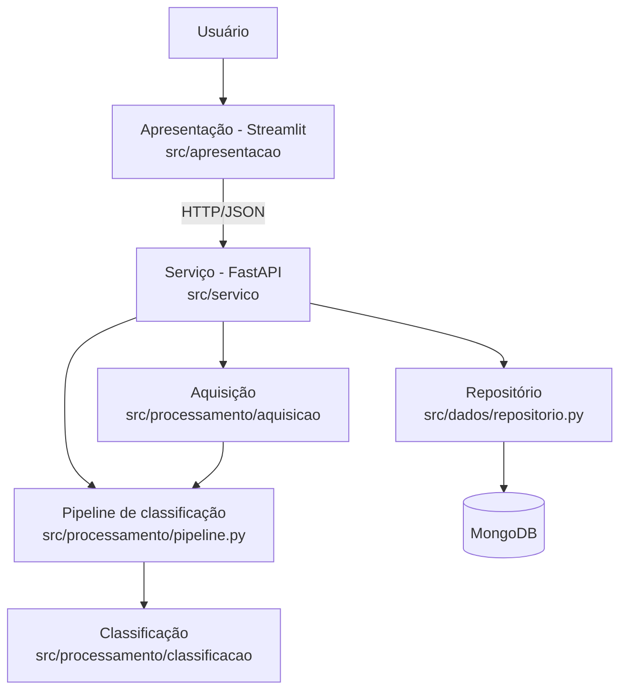

# Arquitetura atual do SentIA

**Referência de implementação:** branch `developer`, após o merge do PR #96.  
**Atualizado em:** 15/11/2026.

Este documento descreve a implementação observada no código. Os documentos acadêmicos formais continuam sendo os artefatos de referência de escopo e arquitetura aprovados; este texto é documentação técnica do software e não os substitui.

## 1. Visão geral

O SentIA é organizado em quatro camadas: **Apresentação**, **Serviço**, **Processamento** e **Dados**. A aplicação Streamlit consome a API REST em FastAPI; o serviço coordena os módulos de processamento e a persistência centralizada em MongoDB.



A API não ocupa um pacote independente `src/api/`: suas rotas e coordenação pertencem à camada `src/servico/`. A camada de dados não deve ser acessada diretamente pelo Streamlit.

## 2. Camada de apresentação

**Localização:** `src/apresentacao/`  
**Tecnologia:** Streamlit.

Responsabilidades:

- apresentar o dashboard e a área administrativa;
- fornecer filtros e componentes de visualização;
- consumir a API por clientes HTTP;
- disponibilizar fontes mock para demonstração e testes sem backend real.

Estrutura relevante:

- `app.py`: ponto de entrada e navegação;
- `paginas/`: dashboard e administração;
- `secoes/`: filtros e indicadores;
- `fontes/api.py` e `fontes/administracao_api.py`: clientes HTTP;
- `fontes/mock.py` e `fontes/administracao_mock.py`: implementações simuladas;
- `config.py`, `contrato.py`, `transformacoes.py`, `componentes.py` e `tema.py`: configuração, contratos de visualização e elementos da interface.

O modo padrão é configurável por `SENTIA_FONTE_DADOS`. Em modo `mock`, os dados apresentados são exemplos fictícios; em modo `api`, o painel consome o backend configurado em `SENTIA_API_URL`.

## 3. Camada de serviço

**Localização:** `src/servico/`  
**Tecnologias:** FastAPI e Uvicorn.

Responsabilidades:

- expor os contratos HTTP;
- validar requisições por esquemas;
- coordenar pipeline e repositório;
- autenticar as operações administrativas;
- tratar erros de serviço, classificação e persistência.

Módulos relevantes:

- `main.py`: criação da aplicação e rotas de análise;
- `administracao.py`: rotas de login, datasets e coletas;
- `autenticacao.py`: criação/validação de sessão administrativa;
- `dependencias.py`: composição das dependências da aplicação;
- `esquemas.py`: modelos de entrada e saída;
- `pesquisa.py`: coordenação da pesquisa por assunto.

### Endpoints principais observados

| Método | Rota | Finalidade |
|---|---|---|
| `GET` | `/health` | Verificação de disponibilidade da API. |
| `POST` | `/analises` | Processa lote de registros e persiste os resultados. |
| `GET` | `/analises` | Consulta paginada e filtrada de análises. |
| `GET` | `/analises/resumo` | Retorna agregados/resumo das análises. |
| `POST` | `/auth/login` | Inicia sessão administrativa. |
| `POST` | `/auth/logout` | Encerra sessão administrativa. |
| `POST` | `/datasets` | Recebe/importa dataset CSV. |
| `GET` | `/coletas/fontes` | Lista fontes de coleta disponíveis. |
| `POST` | `/coletas` | Solicita uma coleta/processamento. |
| `GET` | `/coletas/{id_coleta}` | Consulta o estado de uma coleta. |

A documentação OpenAPI gerada pelo FastAPI fica disponível por padrão em `/docs` quando a API está em execução. O acesso administrativo e a proteção de `/analises*` são assuntos distintos; não presumir que todas as rotas exigem a mesma autenticação.

## 4. Camada de processamento

**Localização:** `src/processamento/`  
**Tecnologias:** Python, PySentimiento/Transformers para o classificador principal e scikit-learn para o baseline.

### 4.1 Aquisição

`src/processamento/aquisicao/` contém adaptadores e rotinas para:

- importação de CSV (`csv_importer.py`);
- corpus TweetSentBR (`tweetsentbr.py`);
- adaptador BPSAD (`bpsad_adapter.py`);
- coleta paginada via XFetch (`xfetch.py`);
- auditoria e identificação de datasets (`auditoria_datasets.py`).

### 4.2 Pipeline

`src/processamento/pipeline.py` coordena a classificação em lote e organiza os registros de entrada e saída, preservando os campos necessários para rastreabilidade da origem.

### 4.3 Classificação

`src/processamento/classificacao/` contém:

- `bertweet.py`: adaptador para `pysentimiento/bertweet-pt-sentiment`;
- `baseline.py`: baseline experimental TF-IDF + Regressão Logística;
- `avaliacao.py`: cálculo de métricas;
- `rotulos.py`: padronização dos rótulos.

A dependência pesada do classificador real é opcional e instalada pelo grupo `ml` do `uv`. O baseline e os artefatos de avaliação não devem ser apresentados como substitutos do modelo principal sem decisão técnica.

### 4.4 Pré-processamento

Existe o pacote `src/processamento/preprocessamento/`, mas, no corte analisado, ele contém apenas `__init__.py`. Não há módulo de pré-processamento textual independente visível nesse diretório. Não descrever uma rotina que não esteja implementada nem criar uma camada artificial nesta tarefa.

## 5. Camada de dados

**Localização:** `src/dados/`  
**Tecnologia:** PyMongo e MongoDB.

- `database.py`: conexão e encerramento do cliente MongoDB;
- `repositorio.py`: operações de persistência, consulta, índices, registros de origem, datasets, análises e cache de pesquisa.

Após o PR #96, a persistência de análises, registros, datasets/corpus e cache de pesquisas foi unificada no repositório MongoDB. As sessões administrativas e estados transitórios de jobs de coleta permanecem no processo da API; isso não equivale a manter todos os dados funcionais apenas em memória.

As principais coleções citadas pela implementação são `analises`, `registros`, `datasets` e `pesquisas`. Os detalhes de esquema e contratos devem permanecer nos documentos especializados de banco e dados.

## 6. Fluxo de dados simplificado

1. Os textos entram por datasets CSV, TweetSentBR, BPSAD ou coleta externa configurada.
2. A camada de serviço valida a requisição e aciona os módulos de aquisição/pipeline necessários.
3. O pipeline chama o classificador configurado e prepara os documentos de saída.
4. O repositório persiste e consulta os registros no MongoDB.
5. A API disponibiliza os resultados para o painel Streamlit por HTTP/JSON.

A pesquisa por assunto consulta a base persistida e pode complementar a aquisição via XFetch quando configurada. A pesquisa lexical atual não deve ser confundida com busca vetorial/embeddings.

## 7. Configuração e execução

O gerenciador oficial de dependências é `uv`, com versões fixadas em `uv.lock`.

```bash
uv sync --locked
```

Para instalar as dependências opcionais do classificador BERTweet real:

```bash
uv sync --locked --group ml
```

Com `MONGODB_URI` configurado, iniciar a API:

```bash
uv run uvicorn src.servico.main:app --host 127.0.0.1 --port 8000 --reload
```

Em outro terminal, iniciar o painel conectado à API:

```bash
SENTIA_FONTE_DADOS=api SENTIA_API_URL=http://127.0.0.1:8000 uv run streamlit run src/apresentacao/app.py
```

Para demonstração offline do painel:

```bash
SENTIA_FONTE_DADOS=mock SENTIA_MOCK_CENARIO=normal uv run streamlit run src/apresentacao/app.py
```

No PowerShell, definir as variáveis no terminal antes de executar:

```powershell
$env:SENTIA_FONTE_DADOS = "api"
$env:SENTIA_API_URL = "http://127.0.0.1:8000"
uv run streamlit run src/apresentacao/app.py
```

## 8. Testes e qualidade

A configuração de Pytest está em `pytest.ini`; os testes estão em `tests/`. A CI de `developer` provisiona `mongo:7` e executa Ruff e Pytest com cobertura.

```bash
uv run ruff check src/apresentacao tests/test_painel_*.py
uv run ruff check --isolated --select F,E9 .
uv run pytest -ra --cov=src --cov-report=term-missing
uv lock --check
```

A execução dos testes de integração com MongoDB local depende de `MONGODB_URI_TESTE`. Não declarar resultados de CI antigos como resultado do HEAD atual sem conferir a execução associada ao SHA.

## 9. Documentos relacionados

- [Índice da documentação](README.md)
- [Contrato de dados](contratos-dados.md)
- [Contrato HTTP entre painel e API](frontend/CONTRATO-API.md)
- [Esquema MongoDB](banco/esquema-mongodb.md)
- [Classificação](classificacao.md)
- [XFetch](integracao_xfetch.md)
- [Diagnóstico do repositório](relatorios/diagnostico-repositorio.md)
