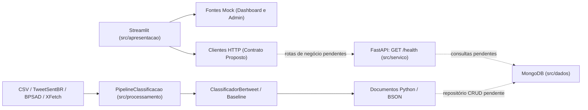

# Arquitetura Observada no PC1

Retrato técnico das quatro camadas do **SentIA** na integração do PC1 (`developer` com PR #65 integrado + PRs #69, #70 e #71).

## Camadas e Responsabilidades

| Camada | Módulos principais | Estado no PC1 |
|---|---|---|
| **Apresentação** | `src/apresentacao/app.py`, `paginas/dashboard.py`, `paginas/administracao.py`, `secoes/filtros.py`, `secoes/indicadores.py`, `fontes/` | Funcional em modo `mock` (indicadores, filtros de período/sentimento, login, upload CSV e coleta simulada). Clientes HTTP (`fontes/api.py` e `fontes/administracao_api.py`) prontos e testados com respostas simuladas |
| **Serviço (API)** | `src/servico/main.py` | Rota `GET /health` operacional. Rotas de análises, resumo e administração propostas em [`docs/frontend/CONTRATO-API.md`](frontend/CONTRATO-API.md) ainda pendentes no backend |
| **Processamento (Aquisição)** | `src/processamento/aquisicao/csv_importer.py`, `tweetsentbr.py`, `bpsad_adapter.py`, `xfetch.py`, `auditoria_datasets.py` | Funcional e coberto por testes unitários e de integração. `xfetch.py` (PR #65) integrado à `developer`, operando com paginação limitada e proteção de metadados |
| **Processamento (ML e Pipeline)** | `src/processamento/classificacao/bertweet.py`, `baseline.py`, `avaliacao.py`, `rotulos.py`, `src/processamento/pipeline.py` | Funcional. `ClassificadorBertweet` preserva o texto bruto (sem stemming ou remoção externa de stopwords) e `PipelineClassificacao` gera documentos BSON válidos em lotes |
| **Dados (MongoDB)** | `src/dados/database.py`, `docs/banco/esquema-mongodb.md` | Gerenciamento explícito de conexão (`conectar_banco`, `fechar_conexao`) testado com mocks. Persistência CRUD e criação automática de índices permanecem para a issue #20 |

## Fronteiras Arquiteturais Verificadas

- O pacote `src/apresentacao/` não importa `src/processamento/` nem `src/dados/` diretamente; essa restrição é validada automaticamente por [`tests/test_painel_arquitetura.py`](../tests/test_painel_arquitetura.py).
- O pipeline produz documentos em memória compatíveis com BSON (`scripts/demonstrar_pipeline.py`), mantendo o desacoplamento entre a inferência de ML e a camada de persistência.
- A proposta de evolução para busca híbrida está documentada em [`docs/pesquisa_hibrida_mongodb_xfetch.md`](pesquisa_hibrida_mongodb_xfetch.md) como arquitetura futura.
