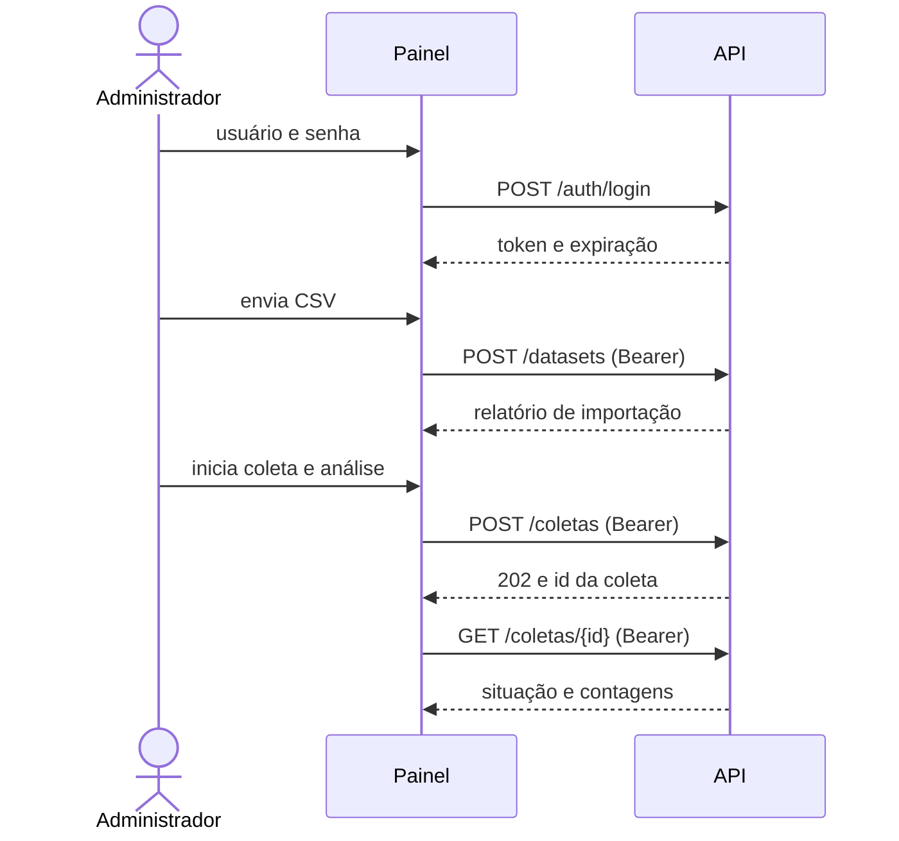

# Contrato entre o painel e a API

**Referência: integração PC1 `bfaf7da`, frontend #70 em `61926fe` mais correção `bcd75e7`, 09/11/2026.**
O #70 está aberto para developer.

**Situação:** o backend oferece somente `GET /health`. As rotas de
análises e de administração abaixo **ainda não existem**. Este documento é uma
**proposta do frontend** para as issues #19, #21, #23, #24, #25 e #58, e pode mudar
quando o contrato for aprovado.

A OpenAPI automática (`/docs`, `/redoc`, `/openapi.json`) não representa novas
rotas funcionais de análise/administração.

No código, a proposta é consumida por `src/apresentacao/fontes/api.py` (análises) e
`fontes/administracao_api.py` (administração). Enquanto o backend não evolui, as telas
usam `fontes/mock.py` e `fontes/administracao_mock.py`, que implementam as mesmas
interfaces (`FonteAnalises` e `FonteAdministracao`, em `contrato.py`). Testes com
respostas simuladas **não comprovam integração**.

## Rotas

| Rota | Situação | Origem |
|---|---|---|
| `GET /health` | **Existe** | `src/servico/main.py` |
| `GET /analises` | Não existe | Proposta; remissão herdada à Arquitetura 2.4.2 não conferida |
| `GET /analises/resumo` | Não existe | **Proposta.** O esquema (seção 4.7) prevê a contagem por sentimento, mas não define a rota |
| `POST /auth/login` | Não existe | **Proposta** (login do Administrador, issue #58) |
| `POST /auth/logout` | Não existe | **Proposta** |
| `POST /datasets` | Não existe | **Proposta**; remissão arquitetural herdada não conferida |
| `GET /coletas/fontes` | Não existe | **Proposta** |
| `POST /coletas` | Não existe | **Proposta**; remissão arquitetural herdada não conferida |
| `GET /coletas/{id}` | Não existe | **Proposta** |

**Por que `/analises/resumo`?** Indicadores, gráfico e resumo precisam de totais sobre
todos os registros filtrados. Calculá-los no painel exigiria baixar todas as páginas,
aumentando o custo de transferência. A meta herdada de até 2 segundos e sua
forma de medição precisam ser confirmadas no Documento de Arquitetura/GQM; não
foram medidas nesta revisão.

## Filtros (propostos para as duas rotas de leitura)

| Parâmetro | Formato | Regra proposta |
|---|---|---|
| `inicio` | `AAAA-MM-DD` | Inclusivo |
| `fim` | `AAAA-MM-DD` | Inclusivo; `inicio` depois de `fim` retorna 422 |
| `sentimento` | `positivo`, `neutro` ou `negativo` | Outro valor retorna 422 |

Somente em `/analises`: `pagina` (a partir de 1) e `tamanho`. O backend define o limite
máximo e uma ordenação determinística (issue #23).

`pagina` e `tamanho` devem ser inteiros positivos; `total` é inteiro não negativo.
Booleanos, números fracionários e números em strings são rejeitados, sem conversão.
`itens` é uma lista com no máximo `tamanho` registros, respeitando o total restante
a partir de `(pagina - 1) * tamanho`. Uma página além do fim pode retornar lista vazia.
Ainda não há limite máximo de tamanho aprovado; o cliente não inventa esse limite.

## Respostas propostas

`GET /analises`: coleção vazia retorna 200 com `itens: []`, sem erro.

```json
{
  "itens": [
    {
      "id_origem": "c_001",
      "fonte": "exemplo_coleta",
      "texto_original": "Texto de exemplo.",
      "sentimento": "negativo",
      "modelo": { "nome": "pysentimiento/bertweet-pt-sentiment" },
      "data_processamento": "2026-10-29T14:30:05Z",
      "data_publicacao": null
    }
  ],
  "pagina": 1,
  "tamanho": 20,
  "total": 1
}
```

Os campos seguem `docs/banco/esquema-mongodb.md`. `data_publicacao` pode ser nula:
datas nunca são inventadas.

O cliente valida os tipos em tempo de execução: `id_origem` é string não vazia,
`fonte` e `texto_original` são strings, `sentimento` é uma das três classes e
`modelo.nome` é string não vazia. Strings apenas com espaços não servem como ID ou
nome de modelo. Datas devem ser strings ISO 8601 com horário e fuso; offsets válidos
são normalizados para UTC. Ausência ou `null` em `data_publicacao` representa data
desconhecida; string vazia e datetime sem fuso são rejeitados.

`GET /analises/resumo`:

```json
{
  "total": 3,
  "por_sentimento": { "positivo": 1, "neutro": 1, "negativo": 1 },
  "sem_data_publicacao": 2
}
```

`sem_data_publicacao` conta os registros deixados de fora do filtro de período por não
terem data. Sem filtro de período, vale 0. Quando é maior que 0, o dashboard avisa
quantos textos ficaram de fora, como recomenda o esquema (seção 4.7).

`total` conta somente os registros que atendem aos filtros e deve ser igual à soma
das contagens das três classes em `por_sentimento`. Essas contagens e
`sem_data_publicacao` são inteiros não negativos, sem booleanos ou coerção de strings.
`por_sentimento` contém exatamente `positivo`, `neutro` e `negativo`.
Os excluídos sem data não entram no total filtrado e podem superar esse total.
Sem filtro de período, `sem_data_publicacao` deve ser 0; quando omitido, assume 0
por compatibilidade com o contrato inicial. Respostas inválidas geram `ErroFonteDados`.

## Erros

| Situação | Mensagem exibida no painel |
|---|---|
| Sem conexão | Não foi possível conectar à API... |
| Tempo esgotado | A API demorou demais para responder. |
| 400 ou 422 | A API recusou os filtros informados. |
| 404 | A API não oferece a rota... |
| Outros códigos | A API retornou um erro inesperado (HTTP N). |
| Corpo inválido ou fora do contrato | A resposta da API não segue o contrato. |

## Administração

A proposta de **login e senha** está registrada na [issue #58](https://github.com/FGA0138-MDS-Ajax/2026.2-T03-Liskov/issues/58).
Ainda não há autenticação implementada no backend desta referência. As rotas
propostas de administração deverão exigir o cabeçalho `Authorization: Bearer <token>`. O painel mantém o token em `st.session_state`, estado no servidor associado à
sessão Streamlit; não é armazenamento persistente do navegador. Não há persistência
implementada de credenciais; a alegação de limpeza da senha do widget não foi
validada nesta revisão.



### `POST /auth/login`

Corpo: `{"usuario": "admin", "senha": "..."}`. Resposta 200:

```json
{ "token": "eyJ...", "usuario": "admin", "expira_em": "2026-11-30T18:00:00Z" }
```

`token` e `usuario` são strings não vazias. `expira_em` é ISO 8601 com fuso. Credencial
errada retorna **401** com mensagem genérica, sem dizer qual campo errou. A API deve guardar a
senha com hash e pode limitar tentativas com **429**.

### `POST /auth/logout`

Deverá invalidar o token e responder **204** quando implementado. O painel encerra a sessão local mesmo se essa chamada
falhar.

### `POST /datasets`

Envio `multipart/form-data` com o campo `arquivo` (CSV em UTF-8). As colunas seguem o
importador do backend (`src/processamento/aquisicao/csv_importer.py`): `texto` ou
`texto_original` e `fonte` são obrigatórias; `id`, `sentimento` e `data` são opcionais.
Resposta **201**:

```json
{
  "id_dataset": "ds_20261107_01",
  "nome_arquivo": "comentarios.csv",
  "registros_lidos": 120,
  "registros_importados": 117,
  "registros_descartados": 3,
  "descartes_por_motivo": { "texto_vazio": 2, "colunas_excedentes": 1 }
}
```

`registros_lidos` deve ser igual a importados + descartados. Na proposta futura, a importação gravará textos e o Administrador escolherá
o dataset em "Coleta e análise" para classificá-los. O dataset deverá aparecer
em `GET /coletas/fontes`. **Hoje o mock só contabiliza o CSV, usa fonte fixa e
não grava nem classifica; o backend não implementa essa operação.**

### `GET /coletas/fontes`

Lista o que pode ser coletado e analisado: fontes externas e datasets importados.

```json
{ "fontes": [ { "id": "tweetsentbr", "nome": "TweetSentBR" } ] }
```

### `POST /coletas` e `GET /coletas/{id}`

`POST /coletas` recebe `{"fonte": "tweetsentbr"}`, inicia a coleta e a análise em segundo
plano e responde **202** com a coleta. `GET /coletas/{id}` devolve a situação atual. O painel
consulta quando o Administrador clica em "Atualizar situação".

```json
{
  "id": "col_42",
  "fonte": "tweetsentbr",
  "situacao": "em_andamento",
  "textos_coletados": 800,
  "textos_analisados": 350,
  "mensagem": null
}
```

`situacao` é `pendente`, `em_andamento`, `concluida` ou `falhou`. `textos_analisados` nunca
supera `textos_coletados`. Em `falhou`, `mensagem` explica o problema em linguagem simples.

### Erros da administração

| Situação | Mensagem exibida no painel |
|---|---|
| 401 no login | Usuário ou senha inválidos. |
| 401 em rota protegida | Sua sessão expirou. Entre novamente. (volta ao login) |
| 403 | Este usuário não tem permissão de administrador. |
| 400, 415 ou 422 | O campo `mensagem` do corpo, se for um texto de até 300 caracteres; senão, uma mensagem padrão |
| 413 | O arquivo é maior que o limite aceito pela API. |
| 429 | Muitas tentativas. Aguarde um pouco e tente de novo. |

Erros de conexão, tempo esgotado, 404 e respostas fora do contrato seguem a tabela de
[erros](#erros).

## Pontos em aberto

1. Qual data o filtro de período usa (alinhamento da equipe; issue #24).
2. Fuso horário usado para interpretar `inicio` e `fim` (issue #24).
3. Dados para o gráfico "Evolução no período", se for mantido (alinhamento da equipe).
4. Confirmar responsáveis e aceite das issues #21, #23, #24, #25 e #58 no planejamento.
5. Formato do token (JWT ou opaco), tempo de expiração e limite de tentativas de login.
6. Tamanho máximo do CSV aceito por `POST /datasets`.
7. Quais fontes externas a coleta oferece além do TweetSentBR (depende da decisão sobre a
   busca por palavra-chave).

## Como trocar o mock pela API

1. O backend publica as rotas e o contrato é aprovado na issue #19.
2. Ajustar `fontes/api.py` e `tests/test_painel_fonte_api.py` se o contrato mudar.
3. Definir `SENTIA_FONTE_DADOS=api` e `SENTIA_API_URL`. As telas não mudam.

## Fronteira com dados e verificação

`sentimento` é previsão, enquanto `rotulo_original` e `rotulo_padronizado` são
anotações da fonte. O CSV pode chamar uma anotação de `sentimento`; o importador
a converte em rótulo humano, sem criar previsão. Probabilidades e datas seguem
os [contratos de dados](../contratos-dados.md).

O cliente existe em `fontes/api.py` e `fontes/administracao_api.py`; isso comprova
preparação para o contrato, não disponibilidade da rota.
[tests/test_painel_fonte_api.py](../../tests/test_painel_fonte_api.py) e
[tests/test_painel_administracao.py](../../tests/test_painel_administracao.py)
usam respostas HTTP simuladas. [tests/test_api.py](../../tests/test_api.py)
cobre o `/health` real via TestClient. `tests/test_api_administracao.py` não
existe nesta referência. Conferir rotas em `uv run python -c
"from src.servico.main import app; print(list(app.openapi()['paths']))"`.
