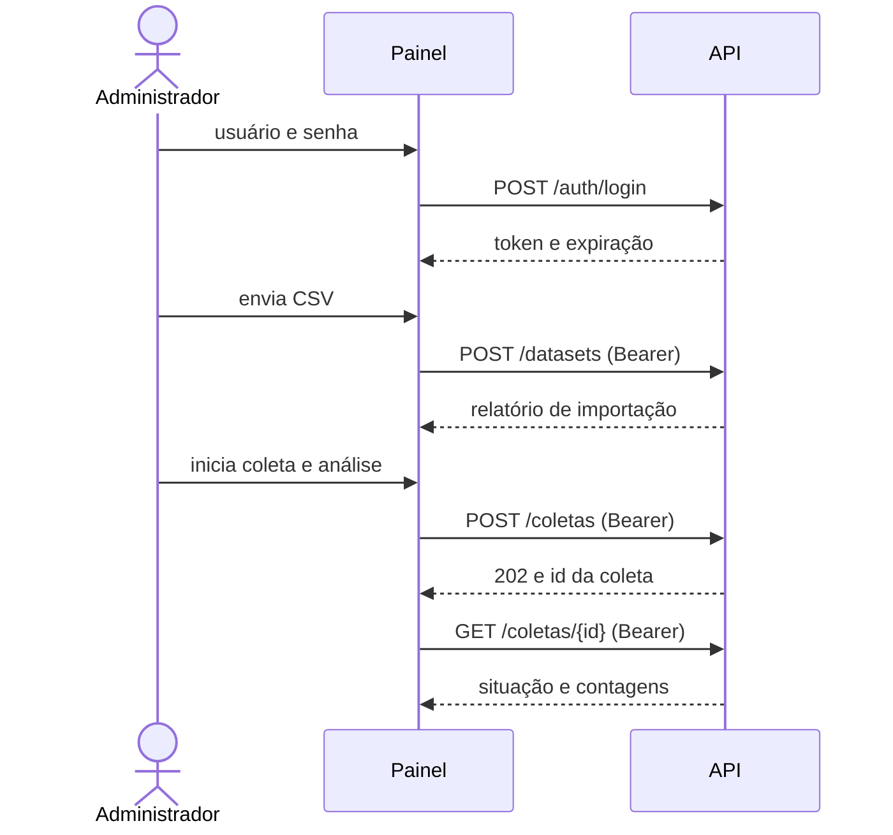

# Contrato entre o painel e a API

**Situação após a implementação das issues #23, #24 e #25:** o backend oferece
`GET /health`, `POST /analises`, as duas rotas de consulta de análises e as rotas de
administração listadas abaixo. O contrato de leitura segue a proposta do frontend;
a escolha de `data_publicacao` como referência temporal ainda requer validação da PO.

No código, a proposta é consumida por `src/apresentacao/fontes/api.py` (análises) e
`fontes/administracao_api.py` (administração). Enquanto o backend não evolui, as telas
usam `fontes/mock.py` e `fontes/administracao_mock.py`, que implementam as mesmas
interfaces (`FonteAnalises` e `FonteAdministracao`, em `contrato.py`). Testes com
respostas simuladas **não comprovam integração**.

## Rotas

| Rota | Situação | Origem |
|---|---|---|
| `GET /health` | **Existe** | `src/servico/main.py` |
| `POST /analises` | **Implementada** | Issue #21: classificação e persistência de lotes |
| `GET /analises` | **Implementada** | Issues #23, #24 e #25: consulta MongoDB com paginação e filtros |
| `GET /analises/resumo` | **Implementada** | Agregação MongoDB do mesmo conjunto filtrado, sem paginação |
| `POST /auth/login` | **Implementada** | Administração (PR #75) |
| `POST /auth/logout` | **Implementada** | Administração (PR #75) |
| `POST /datasets` | **Implementada** | Administração (PR #75) |
| `GET /coletas/fontes` | **Implementada** | Administração (PR #75) |
| `POST /coletas` | **Implementada** | Administração (PR #75) |
| `GET /coletas/{id}` | **Implementada** | Administração (PR #75) |

**Por que `/analises/resumo`?** Indicadores, gráfico e resumo precisam de totais sobre
todos os registros filtrados. Calculá-los no painel exigiria baixar todas as páginas,
contrariando a meta de resposta em até 2 segundos e a regra de filtrar no banco.

## Filtros implementados nas duas rotas de leitura

| Parâmetro | Formato | Regra proposta |
|---|---|---|
| `inicio` | `AAAA-MM-DD` | Inclusivo |
| `fim` | `AAAA-MM-DD` | Inclusivo; `inicio` depois de `fim` retorna 422 |
| `sentimento` | `positivo`, `neutro` ou `negativo` | Outro valor retorna 422 |

Somente em `/analises`: `pagina` (padrão 1, a partir de 1) e `tamanho` (padrão 20,
máximo 100); valores fora dos limites retornam 422. A ordenação usa
`data_processamento` decrescente, seguida de `fonte` e `id_origem` crescentes.
A chave única `(fonte, id_origem)` desempata datas iguais. A paginação usa skip/limit
no banco; escritas concorrentes podem alterar as páginas entre requisições.

O período usa `data_publicacao`: `inicio` começa às 00:00:00 UTC e `fim` inclui
todo o último dia em UTC. Datas inexistentes, fora de `AAAA-MM-DD` ou intervalos
invertidos retornam 422. Registros sem publicação (campo ausente ou nulo) só são
excluídos quando há filtro temporal. A data de referência precisa de validação da PO.

`pagina` e `tamanho` devem ser inteiros positivos; `total` é inteiro não negativo.
Na resposta JSON, booleanos, números fracionários e números em strings são rejeitados
pelo cliente, sem conversão. Na query HTTP, paginação é enviada como inteiros em texto.
`itens` é uma lista com no máximo `tamanho` registros, respeitando o total restante
a partir de `(pagina - 1) * tamanho`. Uma página além do fim pode retornar lista vazia.
O limite técnico implementado no backend é 100; o cliente não altera esse limite.

## Respostas implementadas de leitura

`GET /analises`: coleção vazia retorna 200 com `itens: []`, sem erro.

```json
{
  "itens": [
    {
      "id_origem": "c_001",
      "fonte": "exemplo_coleta",
      "texto_original": "Texto de exemplo.",
      "sentimento": "negativo",
      "modelo": { "nome": "pysentimiento/bertweet-pt-sentiment" },
      "data_processamento": "2026-10-29T14:30:05Z",
      "data_publicacao": null
    }
  ],
  "pagina": 1,
  "tamanho": 20,
  "total": 1
}
```

Os campos seguem `docs/banco/esquema-mongodb.md`. `data_publicacao` pode ser nula:
datas nunca são inventadas. `_id` não é exposto. Datas BSON são serializadas em
ISO 8601 com fuso UTC, inclusive quando o driver retorna datetime sem tzinfo.

O cliente valida os tipos em tempo de execução: `id_origem` é string não vazia,
`fonte` e `texto_original` são strings, `sentimento` é uma das três classes e
`modelo.nome` é string não vazia. Strings apenas com espaços não servem como ID ou
nome de modelo. Datas devem ser strings ISO 8601 com horário e fuso; offsets válidos
são normalizados para UTC. Ausência ou `null` em `data_publicacao` representa data
desconhecida; string vazia e datetime sem fuso são rejeitados.

`GET /analises/resumo`:

```json
{
  "total": 3,
  "por_sentimento": { "positivo": 1, "neutro": 1, "negativo": 1 },
  "sem_data_publicacao": 2
}
```

`sem_data_publicacao` conta os registros deixados de fora do filtro de período por não
terem data. Sem filtro de período, vale 0. Quando é maior que 0, o dashboard avisa
quantos textos ficaram de fora, como recomenda o esquema (seção 4.7).
Essa contagem respeita o filtro de sentimento e não depende da página solicitada.
Total e contagens por sentimento são agregados no banco, sem baixar todas as análises.

`total` conta somente os registros que atendem aos filtros e deve ser igual à soma
das contagens das três classes em `por_sentimento`. Essas contagens e
`sem_data_publicacao` são inteiros não negativos, sem booleanos ou coerção de strings.
`por_sentimento` contém exatamente `positivo`, `neutro` e `negativo`.
Os excluídos sem data não entram no total filtrado e podem superar esse total.
Sem filtro de período, `sem_data_publicacao` deve ser 0; quando omitido, assume 0
por compatibilidade com o contrato inicial. Respostas inválidas geram `ErroFonteDados`.

## Erros

| Situação | Mensagem exibida no painel |
|---|---|
| Sem conexão | Não foi possível conectar à API... |
| Tempo esgotado | A API demorou demais para responder. |
| 400 ou 422 | A API recusou os filtros informados. |
| 404 | A API não oferece a rota... |
| Outros códigos | A API retornou um erro inesperado (HTTP N). |
| Corpo inválido ou fora do contrato | A resposta da API não segue o contrato. |

## Administração

O Administrador entra com **login e senha** (decisão da Product Owner de 07/11/2026). As
rotas de administração exigem o cabeçalho `Authorization: Bearer <token>`. O painel guarda o
token só na sessão do navegador (`st.session_state`) e nunca guarda a senha.



### `POST /auth/login`

Corpo: `{"usuario": "admin", "senha": "..."}`. Resposta 200:

```json
{ "token": "eyJ...", "usuario": "admin", "expira_em": "2026-11-30T18:00:00Z" }
```

`token` e `usuario` são strings não vazias. `expira_em` é ISO 8601 com fuso. Credencial
errada retorna **401** com mensagem genérica, sem dizer qual campo errou. A API deve guardar a
senha com hash e pode limitar tentativas com **429**.

### `POST /auth/logout`

Invalida o token. Responde **204**. O painel encerra a sessão local mesmo se essa chamada
falhar.

### `POST /datasets`

Envio `multipart/form-data` com o campo `arquivo` (CSV em UTF-8). As colunas seguem o
importador do backend (`src/processamento/aquisicao/csv_importer.py`): `texto` ou
`texto_original` e `fonte` são obrigatórias; `id`, `sentimento` e `data` são opcionais.
Resposta **201**:

```json
{
  "id_dataset": "ds_20261107_01",
  "nome_arquivo": "comentarios.csv",
  "registros_lidos": 120,
  "registros_importados": 117,
  "registros_descartados": 3,
  "descartes_por_motivo": { "texto_vazio": 2, "colunas_excedentes": 1 }
}
```

`registros_lidos` deve ser igual a importados + descartados. A importação só grava os textos.
Com a opção "Analisar o sentimento logo após importar" (marcada por padrão), o painel chama em
seguida `POST /coletas` com o `id_dataset`; sem ela, o Administrador escolhe o dataset em
"Coleta e análise". Por isso, o dataset importado deve aparecer em `GET /coletas/fontes`.

### `GET /coletas/fontes`

Lista o que pode ser coletado e analisado: fontes externas e datasets importados.

```json
{ "fontes": [ { "id": "tweetsentbr", "nome": "TweetSentBR" } ] }
```

### `POST /coletas` e `GET /coletas/{id}`

`POST /coletas` recebe `{"fonte": "tweetsentbr"}`, inicia a coleta e a análise em segundo
plano e responde **202** com a coleta. `GET /coletas/{id}` devolve a situação atual. O painel
consulta quando o Administrador clica em "Atualizar situação".

```json
{
  "id": "col_42",
  "fonte": "tweetsentbr",
  "situacao": "em_andamento",
  "textos_coletados": 800,
  "textos_analisados": 350,
  "mensagem": null,
  "por_sentimento": { "positivo": 150, "neutro": 120, "negativo": 80 },
  "exemplos": [ { "texto": "Adorei o atendimento", "sentimento": "positivo" } ]
}
```

`situacao` é `pendente`, `em_andamento`, `concluida` ou `falhou`. `textos_analisados` nunca
supera `textos_coletados`. Em `falhou`, `mensagem` explica o problema em linguagem simples.
`por_sentimento` traz a contagem parcial ou final por sentimento (a soma não supera
`textos_analisados`), e `exemplos`, até 10 textos já analisados. Ao concluir, o painel mostra
os indicadores e os exemplos, com `@menções` trocadas por `@usuário`.

### Pesquisa híbrida por assunto (`POST /coletas` com `fonte: "pesquisa"`)

Segue `docs/pesquisa_hibrida_mongodb_xfetch.md`. Na aba **Pesquisar assunto**, o
Administrador informa o assunto, a meta de textos e se o X pode completar a meta. A API:

1. procura o assunto nos textos que já tem (datasets importados, pesquisas anteriores e
   TweetSentBR);
2. se faltar e `complementar_com_x` for `true`, pede ao XFetch **só o que falta**;
3. descarta repetidos pelo par fonte + `id_origem` e guarda os tweets novos na base;
4. classifica tudo com o BERTweet; o painel acompanha por `GET /coletas/{id}`.

```json
{ "fonte": "pesquisa", "termo": "custo de vida", "quantidade": 5, "complementar_com_x": true }
```

- `termo`: texto não vazio de até 100 caracteres. `quantidade`: meta de 1 a 100, um máximo.
- A coleta devolvida inclui `termo` e `origem`, e cada item de `exemplos` traz `origem`:

```json
{
  "origem": { "base": 3, "x": 2, "duplicatas": 1 },
  "exemplos": [ { "texto": "...", "sentimento": "neutro", "origem": "x" } ]
}
```

- Se a base não bastar e o X não puder ser usado, a coleta termina como `concluida` com uma
  `mensagem` explicando quantos textos a base tinha.
- Todas as coletas devolvem `por_sentimento` e até 10 `exemplos`; o painel mascara
  `@menções` antes de exibir.

**Versão de teste (branch `feat/pesquisa-hibrida-admin`, ainda sem issue):** a "base" fica na
memória da API, no lugar do MongoDB (#20), e a busca na base é por palavras (sem acento e por radical; consultas
de até 3 palavras exigem todas no texto), no lugar da busca semântica com embeddings. Cada
consulta ao XFetch é **paga**; a chave fica só no `.env` da API (`XFETCH_API_KEY`). Sem ela, a
pesquisa usa só a base.

### Implementação de referência

`src/servico/administracao.py` e `src/servico/autenticacao.py` implementam estas rotas, para
o backend continuar a partir delas (#58):

- Um único Administrador, configurado por `SENTIA_ADMIN_USUARIO` e `SENTIA_ADMIN_SENHA_HASH`
  (hash scrypt, gerado com `uv run python -m src.servico.autenticacao`). Sem essas variáveis,
  as rotas respondem **503**. Nenhuma credencial fica no repositório.
- Token opaco com expiração de `SENTIA_SESSAO_MINUTOS` (padrão 60) e bloqueio com **429** após
  várias tentativas erradas.
- CSV de até `SENTIA_LIMITE_CSV_MB` (padrão 10 MB) e até `SENTIA_LIMITE_COLETA` textos do
  TweetSentBR por coleta (padrão 1000).
- **Limitação:** datasets, coletas, análises e sessões ficam na memória da API, no lugar do
  MongoDB (#20), e se perdem quando ela reinicia.
- **Memória:** o BERTweet na placa de vídeo, com `--reload`, passou de 5 GB numa máquina de
  6,7 GB. No processador ficou perto de 1,7 GB:
  `env CUDA_VISIBLE_DEVICES= SENTIA_LIMITE_COLETA=300 uv run --group ml uvicorn src.servico.main:app --port 8000`.

### Erros da administração

| Situação | Mensagem exibida no painel |
|---|---|
| 401 no login | Usuário ou senha inválidos. |
| 401 em rota protegida | Sua sessão expirou. Entre novamente. (volta ao login) |
| 403 | Este usuário não tem permissão de administrador. |
| 400, 415 ou 422 | O campo `mensagem` do corpo, se for um texto de até 300 caracteres; senão, uma mensagem padrão |
| 413 | O arquivo é maior que o limite aceito pela API. |
| 404 ou 503 com `mensagem` | O campo `mensagem` do corpo (por exemplo, "Coleta não encontrada.") |
| 429 | Muitas tentativas. Aguarde um pouco e tente de novo. |

Erros de conexão, tempo esgotado, 404 e respostas fora do contrato seguem a tabela de
[erros](#erros).

## Pontos em aberto

1. Validar com a PO a escolha implementada de `data_publicacao` para o período (issue #24).
2. A implementação interpreta `inicio` e `fim` em UTC, com dias inclusivos (issue #24).
3. Dados para o gráfico "Evolução no período", se for mantido (alinhamento da equipe).
4. Responsável pelo backend: as issues #23, #24 e #25 estão sem responsável.
5. Manter ou não as escolhas da implementação de referência: token opaco, sessão de 60 minutos,
   bloqueio de tentativas e CSV de até 10 MB.
6. Guardar datasets, coletas e análises no MongoDB (#20), no lugar da memória.
7. Quais fontes externas a coleta oferece além do TweetSentBR, como o X (XFetch).
8. Pesquisa híbrida: limite de gasto com o XFetch, critério de relevância da busca na base e
   quando trocar a busca por palavras pela busca semântica (Vector Search).

## Como trocar o mock pela API

1. O backend publica as rotas e o contrato é aprovado na issue #19.
2. Ajustar `fontes/api.py` e `tests/test_painel_fonte_api.py` se o contrato mudar.
3. Definir `SENTIA_FONTE_DADOS=api` e `SENTIA_API_URL`. As telas não mudam.
