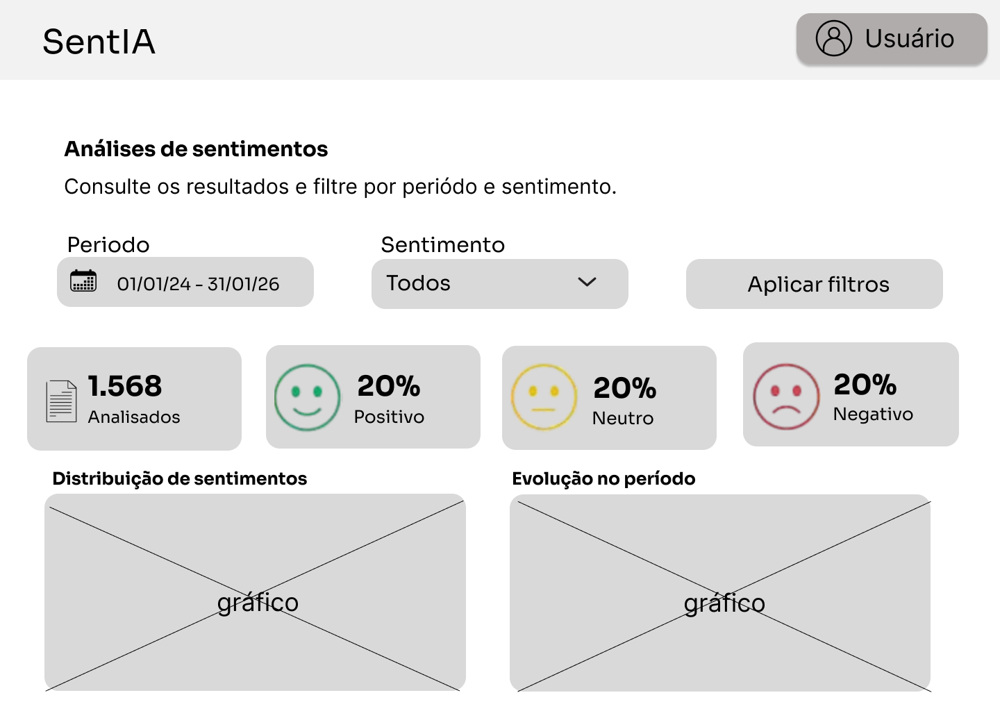
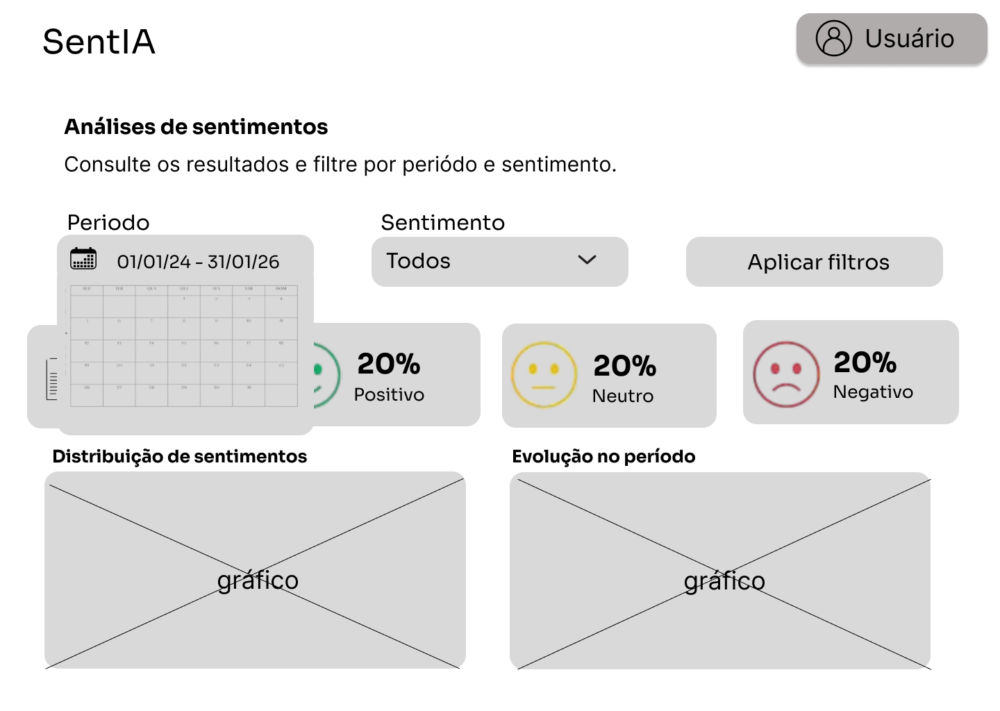
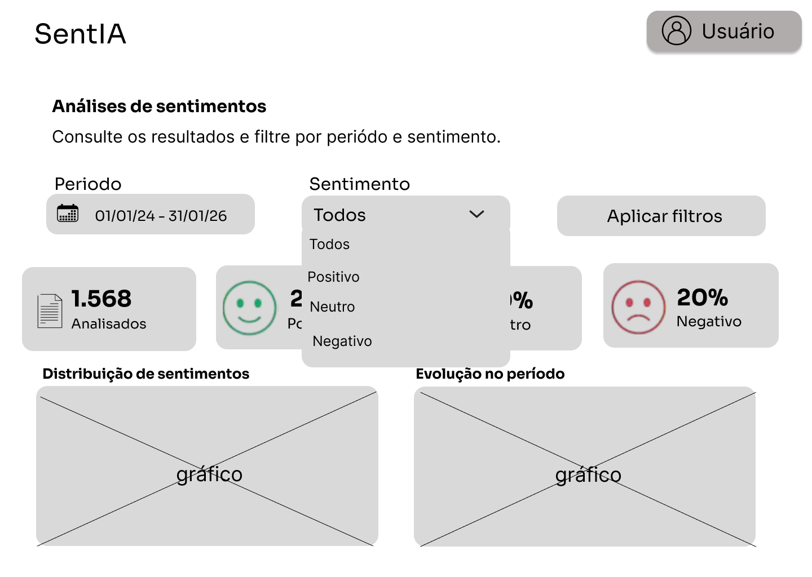
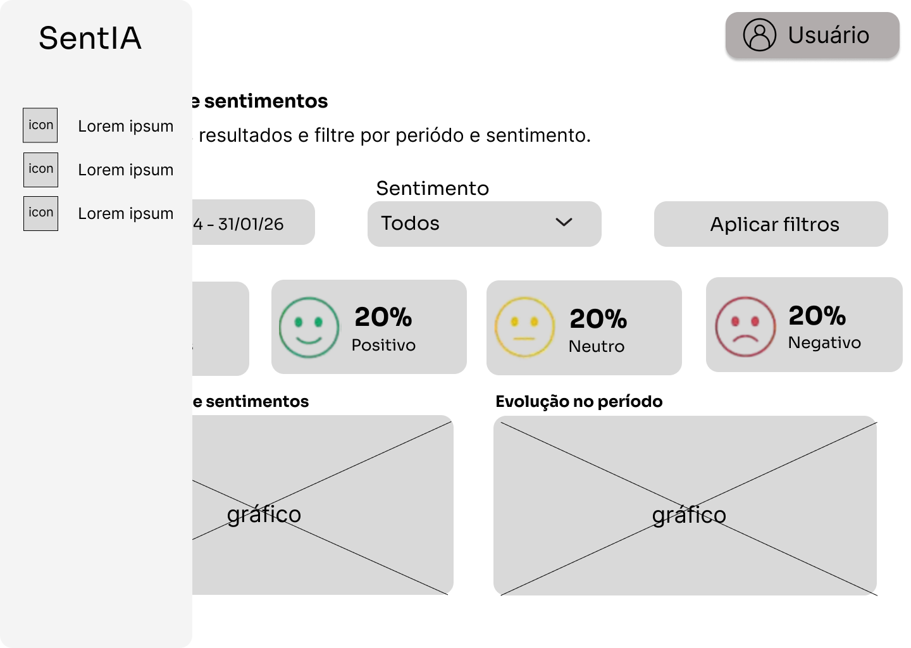

# Wireframes do painel

Wireframes de **baixa fidelidade** do dashboard, feitos no Figma por Héllen e Juliana e trazidos
da branch `feat/pages` (issue #14). Cores, tipografia, ícones e valores são demonstrativos: os
20% de cada sentimento, por exemplo, não somam 100%.

- [Arquivo de design no Figma](https://www.figma.com/design/AN2ZLwqkN4mi59YSXqEquw/Prototipo_SentIA-BF?node-id=0-1)
- [Protótipo navegável](https://www.figma.com/proto/AN2ZLwqkN4mi59YSXqEquw/Prototipo_SentIA-BF?node-id=2011-415&scaling=contain&content-scaling=fixed&page-id=0%3A1&starting-point-node-id=2011%3A415&show-proto-sidebar=1)

Os links do Figma não foram conferidos neste repositório; se estiverem privados, peça acesso à
equipe de frontend.

## Telas

| Tela | O que mostra |
|---|---|
|  | Visão geral: filtros, indicadores, distribuição e evolução no período |
|  | Seleção do período em um calendário |
|  | Filtro de sentimento aberto, com Todos, Positivo, Neutro e Negativo |
|  | Menu lateral de navegação aberto |

A landing page do protótipo não foi trazida: ela ficou fora do escopo por decisão da Product
Owner em 07/11/2026.

## O que já está no painel

| Elemento do wireframe | Situação | Observação |
|---|---|---|
| Título e descrição | Implementado | Inclui o aviso de que o sentimento é uma previsão |
| Filtro de período | Implementado, com dados de exemplo | Dois campos ("a partir de" e "até") em vez de um intervalo: aceitam período aberto e têm rótulo próprio para leitores de tela |
| Filtro de sentimento e "Aplicar filtros" | Implementado, com dados de exemplo | Há também o botão "Limpar" |
| Indicadores | Implementado, com dados de exemplo | Percentuais somam sempre 100% |
| Distribuição de sentimentos | Pendente | Issue #28 |
| Evolução no período | Em decisão | Fora do RF14; depende de alinhamento da equipe |
| Menu lateral | Implementado | Navegação nativa do Streamlit |
| Botão "Usuário" | Substituído | Sem login, o menu mostra "Entrar"; com login, "Administração" |

A área do Administrador ainda não tem wireframe. A implementação atual segue o fluxo descrito na
seção "Administração" de [CONTRATO-API.md](CONTRATO-API.md).
