# Wireframes do painel

Wireframes de **baixa fidelidade** do dashboard, feitos no Figma por Héllen e Juliana e trazidos
da branch `feat/pages` (issue #14). Cores, tipografia, ícones e valores são demonstrativos: os
20% de cada sentimento, por exemplo.

- [Arquivo de design no Figma](https://www.figma.com/design/AN2ZLwqkN4mi59YSXqEquw/Prototipo_SentIA-BF?node-id=0-1&t=tupkJuYNH9G9rf0n-1)

*se estiverem privados, peça acesso à
equipe de frontend.

## Telas

| Tela | O que mostra |
|---|---|
| 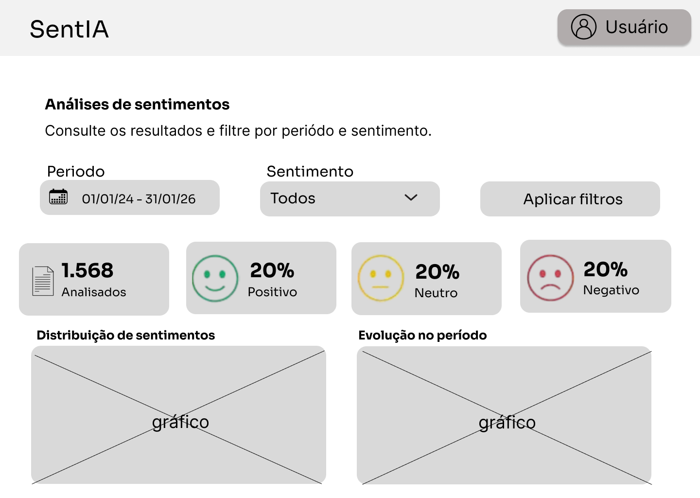 | Visão geral: filtros, indicadores, distribuição e evolução no período |
|  | Seleção do período em um calendário |
| 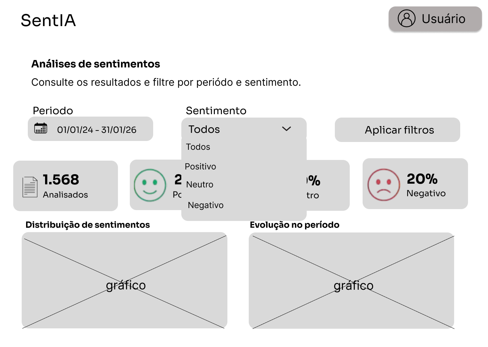 | Filtro de sentimento aberto, com Todos, Positivo, Neutro e Negativo |
| 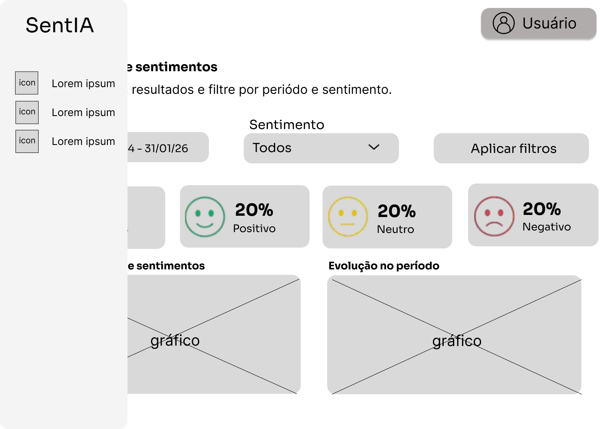 | Menu lateral de navegação aberto |

A landing page do protótipo não foi trazida: ela ficou fora do escopo por decisão da Product
Owner em 07/11/2026.

## O que já está no painel

| Elemento do wireframe | Situação | Observação |
|---|---|---|
| Título e descrição | Implementado | Inclui o aviso de que o sentimento é uma previsão |
| Filtro de período | Implementado, com dados de exemplo | Dois campos ("a partir de" e "até") em vez de um intervalo: aceitam período aberto e têm rótulo próprio para leitores de tela |
| Filtro de sentimento e "Aplicar filtros" | Implementado, com dados de exemplo | Há também o botão "Limpar" |
| Indicadores | Implementado, com dados de exemplo | Percentuais somam sempre 100% |
| Listagem das análises | Implementado | Não consta nos wireframes; exigida pela issue #27 e pelo teste T11. Paginada, 20 por página |
| Distribuição de sentimentos | Implementado | Barras horizontais com quantidade e percentual escritos em cada barra, na mesma ordem e cores dos indicadores; tabela equivalente em um expansor (issue #28) |
| Resumo textual | Implementado | Não consta nos wireframes; exigido pela issue #29. Texto montado por regras (sem modelo de linguagem), logo abaixo do gráfico: total, distribuição e predominância da seleção atual; sem dados, informa a ausência de registros |
| Evolução no período | Em decisão | Fora do RF14; depende de alinhamento da equipe |
| Menu lateral | Implementado | Navegação nativa do Streamlit |
| Botão "Usuário" | Substituído | Sem login, o menu mostra "Entrar"; com login, "Administração" |

A área do Administrador ainda não tinha wireframe até 25/11 criado, mas já estava implementada. A implementação segue o fluxo descrito
na seção "Administração" de [CONTRATO-API.md](CONTRATO-API.md); a proposta de 25/11 (abaixo)
inclui as telas da administração e do login, para registros de evolução.

## Registro de 25/11/2026: painel atual e proposta de melhoria

Capturas de tela inteira, para comparar o painel antes e depois das melhorias visuais. As
capturas estão em [`wireframes/registro-2026-11-25/`](wireframes/registro-2026-11-25/).

- **Antes:** o painel da `developer` em 25/11/2026 (commit `624946a`). O dashboard usa a API e o
  banco reais (1.016 análises). A administração e o login foram capturados no modo de
  demonstração (`SENTIA_FONTE_DADOS=mock`), por isso mostram o aviso "Dados de exemplo".
- **Proposta:** um protótipo navegável **feito em Streamlit**, com dados de exemplo, que serve de
  referência para a implementação. Ele não está no repositório; as telas entram por issues e PRs,
  uma melhoria por vez. Os números do protótipo são fictícios, mas as contagens gerais repetem as
  do painel (1.016 análises: 469, 269 e 278).

### Dashboard (1440 px)

| Antes | Proposta |
|---|---|
| 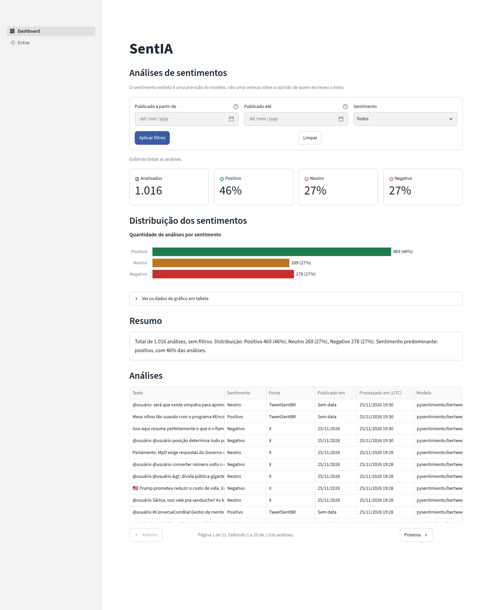 | 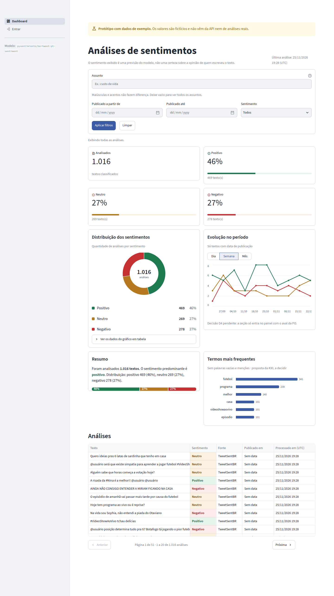 |

- **Campo "Assunto"** nos filtros, que procura só nos textos já guardados na base (issue #113).
- **Botões dos filtros** numa linha própria, que não cortam o rótulo em telas estreitas.
- **Indicadores** em duas linhas de dois, com barra de proporção e a contagem ("469 texto(s)").
- **Distribuição em rosca** com legenda numerada, mantendo a tabela equivalente no expansor.
- **Evolução no período**: exemplo de como ficaria; continua em decisão e depende de textos com
  data de publicação.
- **Resumo** com barra de proporção e **termos mais frequentes** em barras, proposta para a
  issue #30 no lugar da nuvem de palavras (a decidir).
- **Tabela** com o sentimento em etiqueta colorida (cor, texto e contraste de pelo menos 4,5:1);
  a coluna "Modelo" sai da tabela e vai para o menu lateral.
- Percentuais iguais em todos os lugares, sempre somando 100%.

### Filtro por assunto (issue #113)

| Assunto com textos ("futebol") | Assunto sem textos ("vacinação") |
|---|---|
| 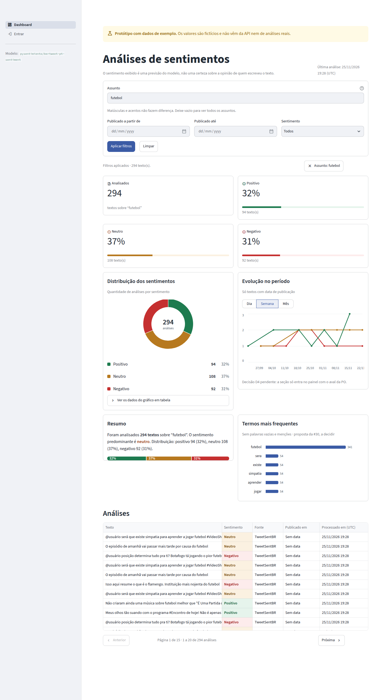 | 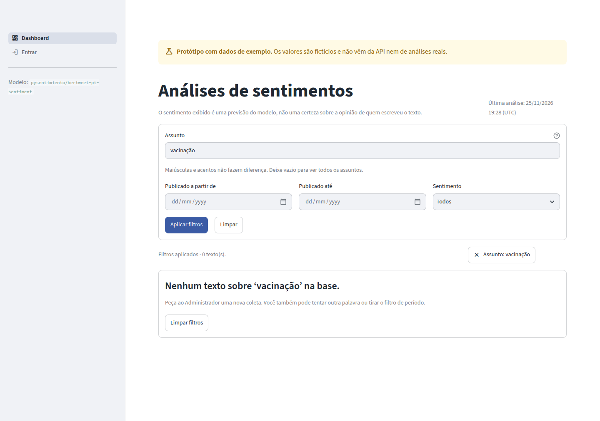 |

O filtro aplicado aparece como um botão "Assunto: X" que remove só o assunto. Sem textos, a tela
mostra a mensagem da issue #113 e não exibe gráficos.

### Responsividade (820 e 390 px)

| | Antes | Proposta |
|---|---|---|
| 820 px | 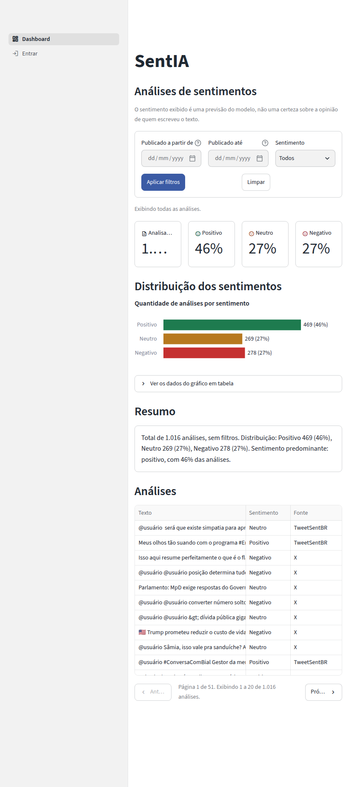 | 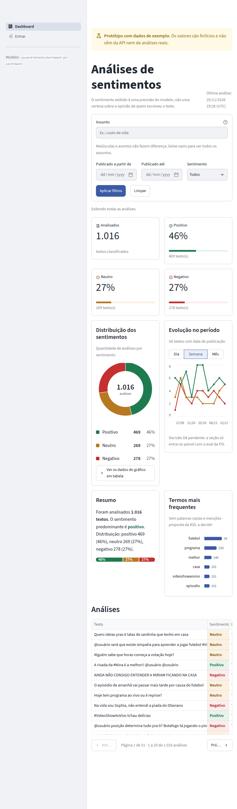 |
| 390 px | 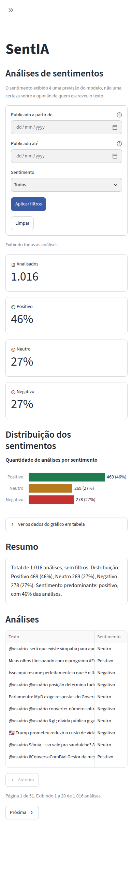 | 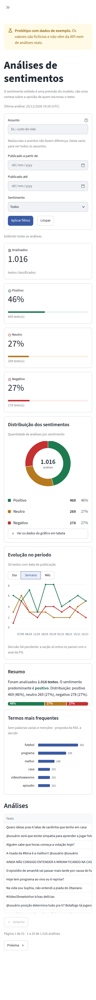 |

### Administração e login (1440 px)

| Tela | Antes | Proposta |
|---|---|---|
| Entrar | 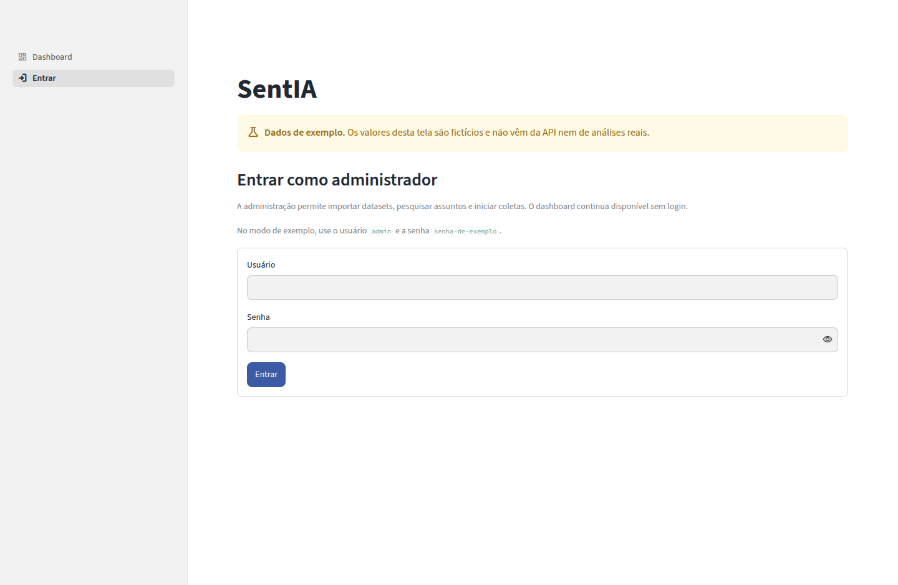 | 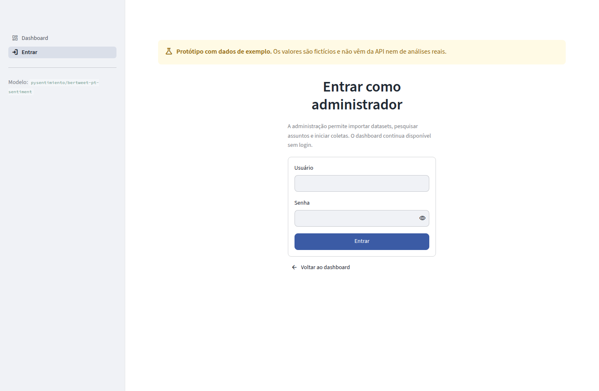 |
| Importar dataset | 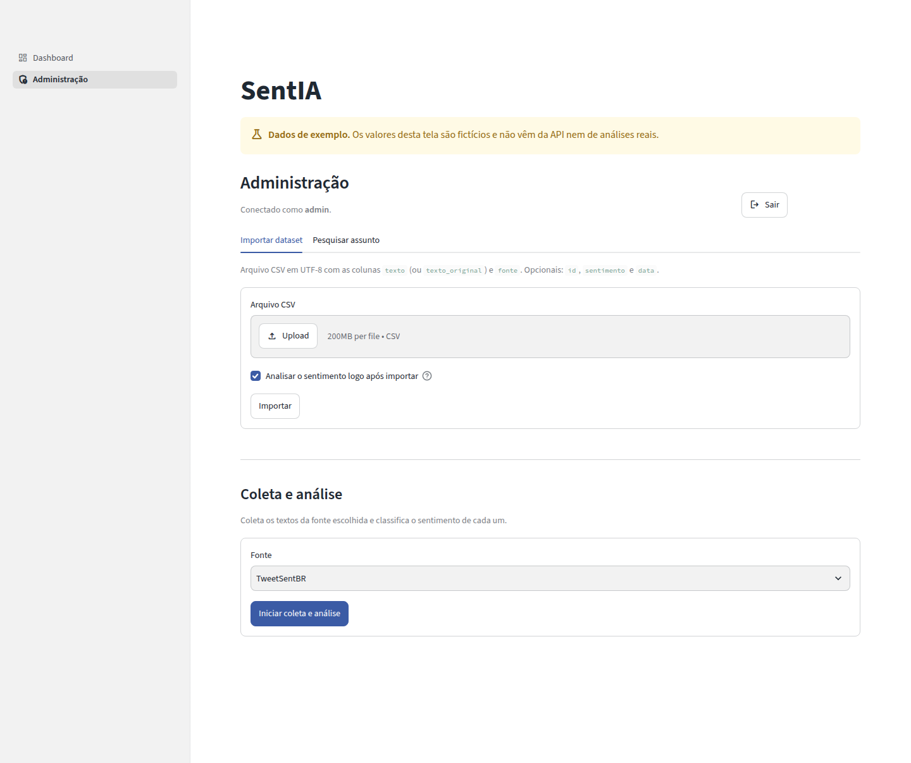 | 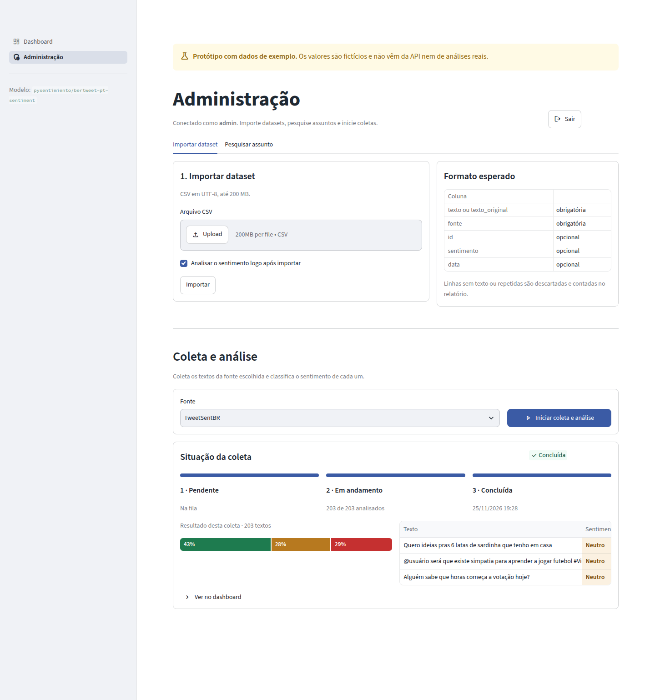 |
| Coleta e análise | 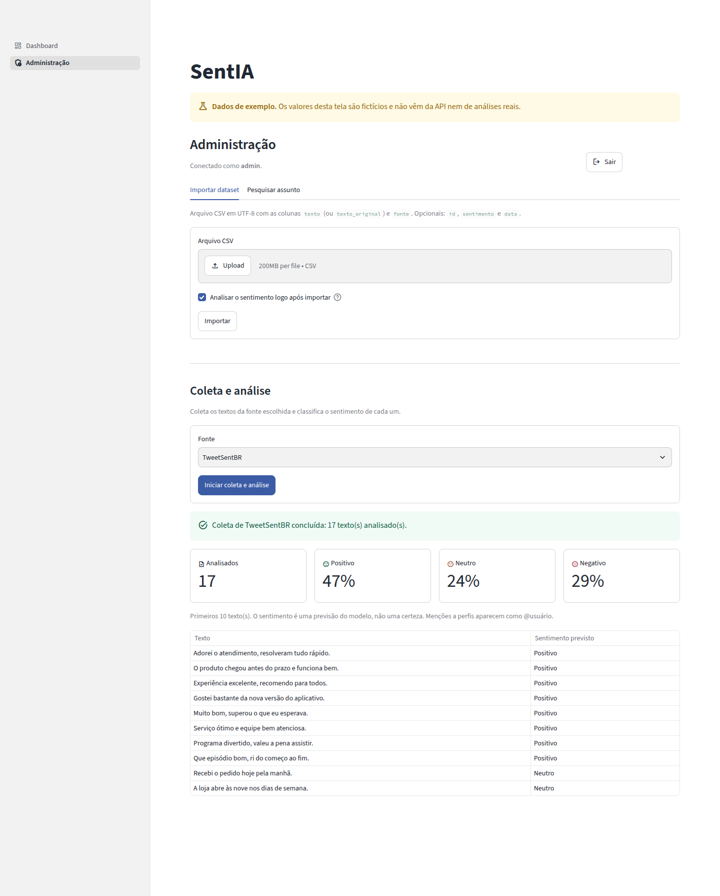 | (na mesma tela da importação, acima) |
| Pesquisar assunto | 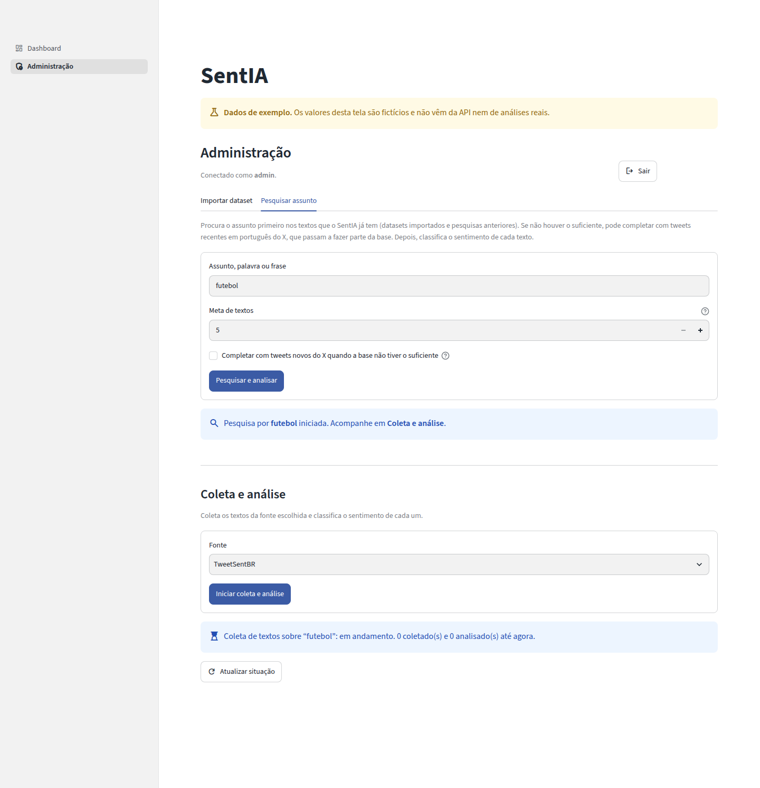 | 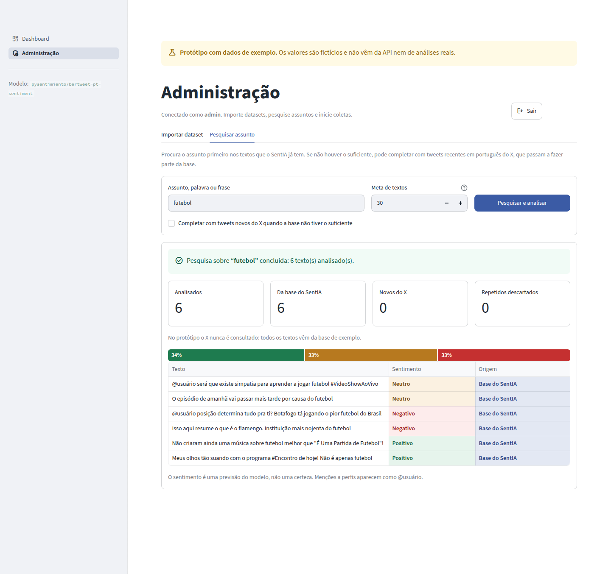 |

O que muda na proposta:

- **Login** num cartão centralizado, com "Voltar ao dashboard".
- **Importação** com o formato esperado do CSV ao lado do envio, e o relatório em três números
  (lidos, importados, descartados) com os motivos dos descartes.
- **Coleta** com as etapas (pendente, em andamento, concluída), o resultado em barra 100% e
  exemplos com etiqueta de sentimento.
- **Pesquisa** com o formulário em uma linha, quatro contadores de origem (base do SentIA, novos
  do X, repetidos) e a coluna "Origem" em etiqueta. No protótipo o X nunca é consultado.
