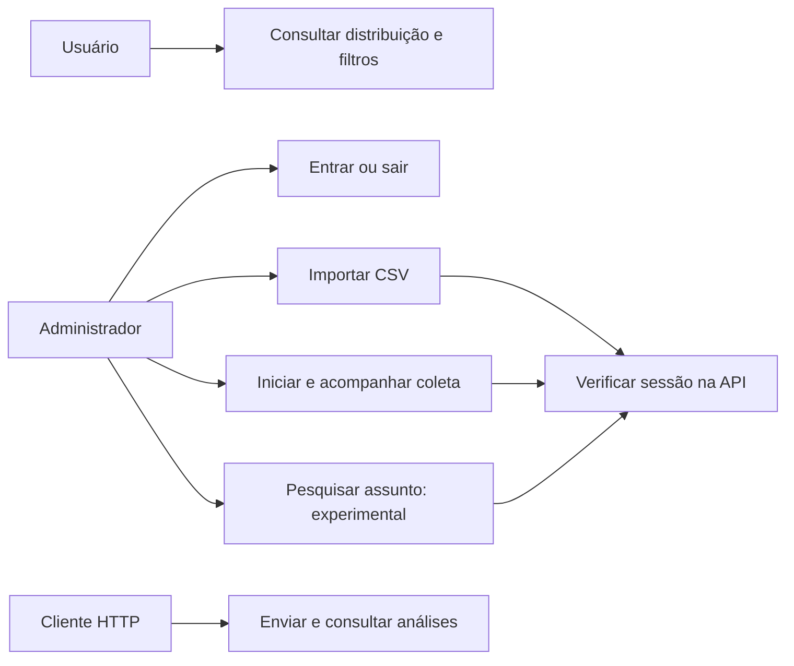
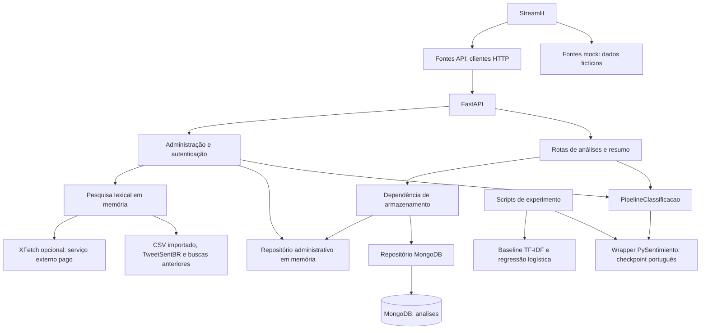
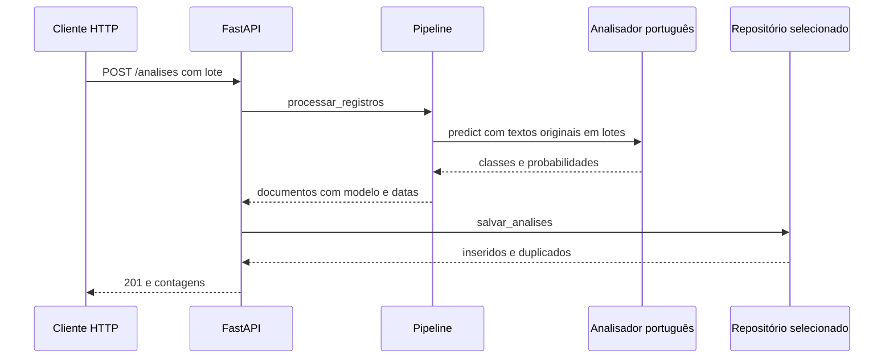
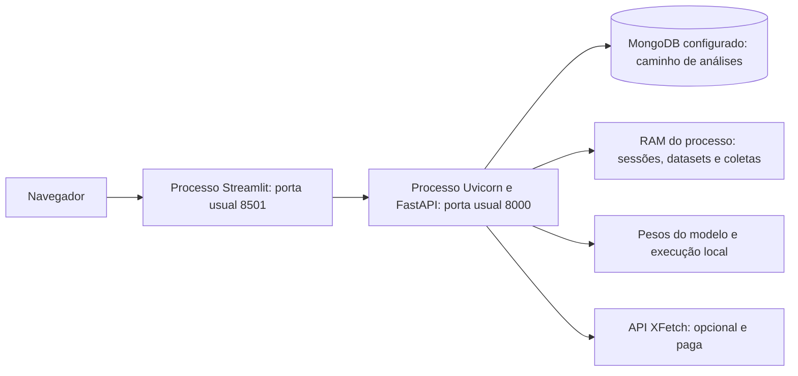

# SentIA — Documento de Arquitetura: rascunho de revisão

**Projeto:** MDS/UnB, 2026.2, T03 Liskov. **Data:** 14/11/2026. **Minuta:** 0.1, sem aceite ou substituição da v1.0.0. **Base:** `developer`, `1723a7d62d55fa98fbf6eaf5cc9da80650dbe920`.

## 1. Identificação, propósito e escopo

Esta arquitetura descreve componentes observados e suas fronteiras para aquisição, inferência, armazenamento e apresentação de sentimentos em português. Sustenta a [Visão proposta](VISAO_ATUALIZADA_RASCUNHO.md) e explicita diferenças entre o produto implementado, a demonstração com mocks e evoluções ainda sujeitas a decisão.

Os PDFs de Arquitetura, Visão e GQM e o pacote de pré-inspeção não foram localizados. A revisão integral de seus textos, integrantes, figuras e bibliografia permanece pendente. A estrutura abaixo cobre as visões requeridas no Quadro 8 do formulário lido, mas não comprova preservação exata da estrutura original. A [matriz](MATRIZ_DIVERGENCIAS.md) conserva a proveniência indireta de alegações sobre os PDFs.

**Quadro 1 — Histórico e responsabilidade da revisão**

| Artefato | Data | Responsabilidade | Estado |
| --- | --- | --- | --- |
| v1.0.0 histórica | N/D | Autores/revisores a conferir no PDF | Preservar |
| Minuta 0.1 | 14/11/2026 | Preparação técnica: Codex, Sol High | Revisão humana e aceite pendentes |
| Nova versão acadêmica | N/D | Héllen e equipe, issue #86 | Publicar somente após reconciliação e decisão |

Fonte: esta revisão e [#86][I86]. O quadro não atribui autoria humana ou aprovação inexistente. As responsabilidades funcionais de dados, ML, UI e QA estão no Quadro 4 da Visão; a tabela completa de integrantes depende do original.

## 2. Definições e decisões estruturantes

O código está organizado em apresentação, serviço, processamento e dados, com um módulo adicional de leitura em `src/persistencia`. Essa organização não deve ser confundida com isolamento físico obrigatório: a API importa processamento e dados no mesmo processo ([C3][C3]–[C7][C7], [C17][C17]).

O wrapper denominado `ClassificadorBertweet` solicita explicitamente `pysentimiento/bertweet-pt-sentiment`, tarefa `sentiment`, idioma `pt`, e processa textos por lotes. A ficha desse checkpoint o associa a BERTabaporu; não se deve usar automaticamente o artigo BERTweet inglês como prova da base portuguesa ([C1][C1]; PYSENTIMIENTO, [s.d.], [R1][R1]). O projeto preserva o nome técnico existente para rastreabilidade. PySentimiento é a biblioteca de acesso ao analisador (PÉREZ et al., 2024, [R2][R2]). A revisão efetiva dos pesos não é fixada pelo wrapper inspecionado.

O texto original é encaminhado ao analisador sem stopwords, stemming ou TF-IDF externos. O tokenizador e as operações internas pertencem à biblioteca/modelo; a ausência de transformação no wrapper não demonstra comportamento interno ou ganho de acurácia ([C1][C1], [C3][C3], [T1][T1]). O [ADR-001][C11] permanece **proposta técnica** aguardando validação formal. Seu relato antigo sobre criação do analisador deve ser atualizado pelo responsável, pois o HEAD já passa `model_name`.

O baseline cria uma pipeline scikit-learn com limpeza mínima, `TfidfVectorizer` de n-gramas 1–2 e regressão logística. Não há stopwords ou stemming explícitos nessa implementação. Ele não precede BERTweet e não é fallback automático do serviço ([C2][C2], [C7][C7]).

## 3. Visão de casos de uso e interfaces do usuário

As denominações UC abaixo são descritivas e locais desta minuta; a numeração definitiva deve ser reconciliada com o diagrama original. A Visão e a [#61][I61] referem UC01–UC03, mas esta revisão não dispõe de todo o catálogo histórico.

**Quadro 2 — Casos de uso e fronteiras**

| Caso | Ator / entrada | Comportamento e saída | Limite e evidência |
| --- | --- | --- | --- |
| Consultar distribuição | Usuário; período/sentimento | Painel consulta resumo e mostra indicadores/estado vazio/erro | Dashboard atual não implementa listagem completa, gráfico nem resumo narrativo [C18][C18] |
| Entrar/sair | Administrador; usuário/senha ou token | API cria sessão com expiração ou revoga token; painel altera navegação | Tokens em memória; reinício encerra sessões [C5][C5], [C8][C8], [C16][C16] |
| Importar CSV | Administrador; arquivo | Valida e armazena dataset administrativo; informa contagens | Armazenamento de dataset em memória; não significa persistência automática em MongoDB [C5][C5] |
| Iniciar/acompanhar coleta | Administrador; fonte | Cria coleta em segundo plano, processa lotes e retorna progresso/exemplos | Repositório administrativo em memória; depende do modelo disponível [C5][C5] |
| Pesquisar assunto | Administrador; termo/meta/opção de X | Seleciona base em memória, complementa opcionalmente via X, remove repetidos e classifica | Experimental, lexical; sem Vector Search/MongoDB nessa seleção [C5][C5], [C9][C9], [P81][P81] |
| Enviar análises | Cliente HTTP; lote de registros | Pipeline infere e grava análises; retorna recebidos/inseridos/duplicados | Rota `/analises` sem exigência de Administrador no HEAD [C4][C4] |

Fonte: módulos citados. O Quadro 2 distingue caso de uso implementado no código de requisito formalmente aceito.

**Figura 1 — Atores e casos de uso observados**

Fonte: elaboração desta revisão a partir de [C4][C4], [C5][C5] e [C16][C16]. A figura mostra as ações protegidas da administração e o acesso HTTP separado, evitando sugerir proteção global da API.

## 4. Visão lógica e componentes

**Figura 2 — Componentes e caminhos de dados no corte**

Fonte: [C1][C1]–[C10][C10], [C15][C15]. A figura explicita que somente a dependência das rotas de análises seleciona MongoDB ou memória; a administração não escreve automaticamente no MongoDB. A conexão XFetch representa capacidade de código, não chamada realizada nesta revisão.

**Quadro 3 — Responsabilidades e interfaces internas**

| Local | Responsabilidade | Contrato / dependências |
| --- | --- | --- |
| `src/apresentacao` | Navegação, filtros, indicadores, login/administração; fontes mock/API | HTTP e contratos próprios; sem importar dados/processamento, restrição testada [T4][T4] |
| `src/servico/main.py`, `esquemas.py` | Rotas de análises, validação Pydantic e respostas | Recebe lote; chama pipeline e repositório; serializa datas [C4][C4], [C19][C19] |
| `src/servico/administracao.py` | Upload, fontes, tarefas e estado administrativo | Contexto cacheado por processo; dataset/coleta/análise em memória [C5][C5] |
| `src/servico/autenticacao.py` | Hash de senha, sessões e limite de tentativas | Configuração de ambiente; sem banco de usuários ou sessão distribuída [C8][C8] |
| `src/servico/pesquisa.py` | Ranquear termos e coordenar complemento X | Função recebe registros e função de busca injetável; devolve origem/duplicatas/aviso [C9][C9] |
| `src/processamento/aquisicao` | CSV, TweetSentBR, BPSAD e XFetch | Registros com identificador/fonte/texto; HTTP fica no adaptador XFetch [C12][C12], [C13][C13] |
| `src/processamento/pipeline.py` | Validar lote e compor documentos de análise | Analisador injetável; mantém identidade, ordem e dados originais [C3][C3] |
| `src/processamento/classificacao` | Wrapper português, rótulos, baseline e métricas | Sentimento e probabilidades normalizados; baseline independente [C1][C1], [C2][C2] |
| `src/dados` | Conexão, índices, inserção, consulta e resumo MongoDB; consulta equivalente em memória | PyMongo e BSON; chave natural fonte/id [C6][C6], [C7][C7] |
| `src/persistencia/leitura.py` | Funções adicionais de leitura/serialização | Coexiste com repositório; não assumir que toda API passa por esse módulo [C17][C17] |

Fonte: arquivos fixados nas referências. O Quadro 3 permite localizar a responsabilidade de cada componente sem reduzir a arquitetura a nomes de tecnologias.

## 5. Interfaces HTTP e contratos de dados

**Quadro 4 — Rotas implementadas**

| Método / rota | Entrada e saída principal | Autorização e falhas |
| --- | --- | --- |
| `GET /health` | `status: ok` | Sem autenticação; não verifica banco/modelo |
| `POST /analises` | `registros` (1–1000); 201 com contagens | Sem dependência de Administrador; 400 validação de domínio, 422 esquema, 503 banco/classificador |
| `GET /analises` | `inicio`, `fim`, `sentimento`, `pagina`, `tamanho`; itens e total | Sem dependência de Administrador; 422 parâmetros, 503 banco |
| `GET /analises/resumo` | Filtros; total, por sentimento, sem data | Sem dependência de Administrador; 503 banco |
| `POST /auth/login` | Usuário/senha; token e expiração | 401 credenciais, 429 limite, 503 sem configuração |
| `POST /auth/logout` | Token Bearer; 204 | Exige sessão administrativa |
| `POST /datasets` | Arquivo multipart CSV; 201 com contagens | Exige sessão; limites de tamanho e validação |
| `GET /coletas/fontes` | Lista de fontes disponíveis | Exige sessão; corpus local aparece quando disponível |
| `POST /coletas` | Fonte e, para pesquisa, termo/meta/opção X; 202 | Exige sessão; execução em `BackgroundTasks`, parâmetros inválidos 422 |
| `GET /coletas/{id_coleta}` | Progresso, situação e exemplos | Exige sessão; 404 coleta inexistente |

Fonte: [C4][C4], [C5][C5] e [C19][C19]. A proteção administrativa é explícita; um cadeado visual na interface não protege outras rotas do serviço.

Entrada canônica do pipeline: `id_origem`, `fonte`, `texto_original`; rótulos originais, data e metadados são opcionais. Saída: sentimento em positivo/negativo/neutro, probabilidades, identificação do modelo e `data_processamento`; publicação ausente continua ausente. Rótulo humano não é substituído pela previsão. Datas de calendário são interpretadas pelo pipeline em UTC; horários sem fuso são recusados ([C3][C3], [C19][C19], [H5][H5]).

MongoDB usa coleção `analises`, índice único composto `(fonte, id_origem)` e índices de sentimento/data, publicação e processamento. Inserções em lote validam documentos antes do driver e contam duplicatas; não afirmar existência de API de atualização/exclusão. A consulta principal filtra publicação por intervalo e sentimento; ordenação/paginação estão no repositório ([C6][C6]). O caminho em memória possui funções de consulta/resumo próprias: equivalência deve ser verificada, não presumida por compartilhar o contrato.

## 6. Visão dinâmica

**Figura 3 — Análise e persistência pela rota principal**

Fonte: [C1][C1], [C3][C3], [C4][C4], [C6][C6]. A figura representa o caso de sucesso; erros de inferência/banco retornam indisponibilidade conforme as rotas. Não implica transação global entre múltiplos lotes.

Na administração, `POST /coletas` agenda tarefa no processo; ela obtém registros, classifica em lotes de 100 e salva no repositório em memória, atualizando progresso. Pesquisa combina base disponível, pontuação lexical e XFetch opcional. Registros novos do X são reaproveitados em pesquisas posteriores no mesmo contexto. Reinício perde esse estado. Não há fila durável demonstrada ([C5][C5], [C9][C9]).

## 7. Visão de implementação e implantação

Python mínimo declarado: 3.11; `.python-version` seleciona 3.11. Dependências são geridas por `pyproject.toml`/`uv.lock`; `ml` inclui PySentimiento 0.7.3 e Torch, e `experimentos` acrescenta medição de memória. Isso não demonstra que pesos e corpus estejam instalados. O código executável de avaliação fica em `scripts/experimentos`; `notebooks` contém apenas marcador na base, sem evidência de treinamento próprio em Colab/Jupyter ([C20][C20], [C10][C10]).

**Figura 4 — Topologia local possível; implantação pública pendente**

Fonte: [C5][C5], [C7][C7], [C15][C15], [H2][H2]. A figura documenta uma configuração de desenvolvimento suportada pelas entradas; não certifica servidor implantado, HTTPS ou alta disponibilidade. O desenho público depende da [#62][I62].

Parâmetros relevantes: `SENTIA_FONTE_DADOS=mock|api` e `SENTIA_API_URL` no painel; `SENTIA_ARMAZENAMENTO=mongodb|memoria` na dependência de análises; configuração MongoDB no ambiente; usuário/hash scrypt/tempo de sessão na administração; chave XFetch para habilitar busca externa. Sem usuário/hash a administração fica desabilitada; sem chave a pesquisa pode operar somente na base ([C7][C7], [C8][C8], [C15][C15], [C5][C5]). Segredos não devem constar nos documentos ou Git.

Uma implantação com múltiplos processos requer decisão sobre sessões e trabalhos, pois os dados administrativos e tokens são locais ao processo. Não há evidência nesta revisão de distribuição de sessão, fila externa, proxy HTTPS ou observabilidade de produção. A existência de autenticação não permite declarar segurança de publicação homologada.

## 8. Restrições, qualidade e validação

Restrições verificadas: apresentação não importa processamento/dados diretamente (teste estático); classificador preserva entrada na fronteira do wrapper (teste com dublê); chave natural evita duplicação de análises no repositório; valores de datas e probabilidades são validados em camadas distintas. Os validadores do repositório não equivalem, por si, a um validador `$jsonSchema` ativo no servidor MongoDB ([T1][T1], [T4][T4], [C3][C3], [C6][C6]).

O workflow instala dependências bloqueadas, confere lock, executa Ruff e pytest, com serviço `mongo:7`. Os testes de analisador e XFetch inspecionados usam dublês; a previsão de serviço no YAML não comprova sucesso do run nem integração real BERTweet/XFetch ([C14][C14], [T1][T1]–[T3][T3]). Esta revisão documental não executou a suíte do produto nem mediu inferência. Há evidência histórica distinta em `docs/qa/`; não atribuir suas contagens ao corte atual.

O [PR #89][P89] continua aberto no corte: resultados BPSAD declarados não foram reproduzidos nesta revisão e não pertencem automaticamente ao código integrado. Não confundir acurácia com F1 macro, memória RSS após execução com pico, ou tempos isolados com benchmark. RNF01 (~80%) permanece a meta original até decisão da PO ([I85][I85], [H4][H4]).

## 9. Evolução e decisões abertas

Antes de consolidar a arquitetura: obter PDFs/pacote; ratificar ADR-001/RF03–RF07; confirmar revisão dos pesos; validar banco e modelo reais; definir autorização para `/analises`; decidir persistência da administração; limitar custos XFetch; tratar busca semântica como evolução independente; escolher infraestrutura de publicação e registrar aceite. A [pauta de decisões](DECISOES_PENDENTES_PO.md) contém perguntas e evidências necessárias. O merge de #81 deve ser contextualizado pela governança, sem presumir autorização nem executar reversão nesta frente.

## 10. Referências

As referências de código abaixo fixam o SHA inspecionado. As referências acadêmicas novas utilizadas são R1 e R2; a bibliografia histórica não pôde ser auditada. A [revisão ABNT](REVISAO_ABNT.md) separa consistência textual verificável de inspeção visual/normativa pendente.

<!-- Referências fixadas no corte; PRs e issues consultados em 14/11/2026. -->
[C1]: https://github.com/FGA0138-MDS-Ajax/2026.2-T03-Liskov/blob/1723a7d62d55fa98fbf6eaf5cc9da80650dbe920/src/processamento/classificacao/bertweet.py#L15
[C10]: https://github.com/FGA0138-MDS-Ajax/2026.2-T03-Liskov/blob/1723a7d62d55fa98fbf6eaf5cc9da80650dbe920/scripts/experimentos/validar_bpsad.py#L1
[C11]: https://github.com/FGA0138-MDS-Ajax/2026.2-T03-Liskov/blob/1723a7d62d55fa98fbf6eaf5cc9da80650dbe920/docs/decisoes/ADR-001-nao-remover-stopwords-no-bertweet.md#L1
[C12]: https://github.com/FGA0138-MDS-Ajax/2026.2-T03-Liskov/blob/1723a7d62d55fa98fbf6eaf5cc9da80650dbe920/src/processamento/aquisicao/xfetch.py#L1
[C13]: https://github.com/FGA0138-MDS-Ajax/2026.2-T03-Liskov/blob/1723a7d62d55fa98fbf6eaf5cc9da80650dbe920/src/processamento/aquisicao/tweetsentbr.py#L1
[C14]: https://github.com/FGA0138-MDS-Ajax/2026.2-T03-Liskov/blob/1723a7d62d55fa98fbf6eaf5cc9da80650dbe920/.github/workflows/ci.yml#L1
[C15]: https://github.com/FGA0138-MDS-Ajax/2026.2-T03-Liskov/blob/1723a7d62d55fa98fbf6eaf5cc9da80650dbe920/src/apresentacao/config.py#L21
[C16]: https://github.com/FGA0138-MDS-Ajax/2026.2-T03-Liskov/blob/1723a7d62d55fa98fbf6eaf5cc9da80650dbe920/src/apresentacao/app.py#L1
[C17]: https://github.com/FGA0138-MDS-Ajax/2026.2-T03-Liskov/blob/1723a7d62d55fa98fbf6eaf5cc9da80650dbe920/src/persistencia/leitura.py#L1
[C18]: https://github.com/FGA0138-MDS-Ajax/2026.2-T03-Liskov/blob/1723a7d62d55fa98fbf6eaf5cc9da80650dbe920/src/apresentacao/paginas/dashboard.py#L1
[C19]: https://github.com/FGA0138-MDS-Ajax/2026.2-T03-Liskov/blob/1723a7d62d55fa98fbf6eaf5cc9da80650dbe920/src/servico/esquemas.py#L8
[C2]: https://github.com/FGA0138-MDS-Ajax/2026.2-T03-Liskov/blob/1723a7d62d55fa98fbf6eaf5cc9da80650dbe920/src/processamento/classificacao/baseline.py#L18
[C20]: https://github.com/FGA0138-MDS-Ajax/2026.2-T03-Liskov/blob/1723a7d62d55fa98fbf6eaf5cc9da80650dbe920/pyproject.toml#L1
[C3]: https://github.com/FGA0138-MDS-Ajax/2026.2-T03-Liskov/blob/1723a7d62d55fa98fbf6eaf5cc9da80650dbe920/src/processamento/pipeline.py#L55
[C4]: https://github.com/FGA0138-MDS-Ajax/2026.2-T03-Liskov/blob/1723a7d62d55fa98fbf6eaf5cc9da80650dbe920/src/servico/main.py#L39
[C5]: https://github.com/FGA0138-MDS-Ajax/2026.2-T03-Liskov/blob/1723a7d62d55fa98fbf6eaf5cc9da80650dbe920/src/servico/administracao.py#L117
[C6]: https://github.com/FGA0138-MDS-Ajax/2026.2-T03-Liskov/blob/1723a7d62d55fa98fbf6eaf5cc9da80650dbe920/src/dados/repositorio.py#L65
[C7]: https://github.com/FGA0138-MDS-Ajax/2026.2-T03-Liskov/blob/1723a7d62d55fa98fbf6eaf5cc9da80650dbe920/src/servico/dependencias.py#L24
[C8]: https://github.com/FGA0138-MDS-Ajax/2026.2-T03-Liskov/blob/1723a7d62d55fa98fbf6eaf5cc9da80650dbe920/src/servico/autenticacao.py#L1
[C9]: https://github.com/FGA0138-MDS-Ajax/2026.2-T03-Liskov/blob/1723a7d62d55fa98fbf6eaf5cc9da80650dbe920/src/servico/pesquisa.py#L1
[H2]: https://github.com/FGA0138-MDS-Ajax/2026.2-T03-Liskov/blob/1723a7d62d55fa98fbf6eaf5cc9da80650dbe920/README.md#L1
[H4]: https://github.com/FGA0138-MDS-Ajax/2026.2-T03-Liskov/blob/1723a7d62d55fa98fbf6eaf5cc9da80650dbe920/docs/experimentos_bpsad.md#L1
[H5]: https://github.com/FGA0138-MDS-Ajax/2026.2-T03-Liskov/blob/1723a7d62d55fa98fbf6eaf5cc9da80650dbe920/docs/contratos-dados.md#L1
[I61]: https://github.com/FGA0138-MDS-Ajax/2026.2-T03-Liskov/issues/61
[I62]: https://github.com/FGA0138-MDS-Ajax/2026.2-T03-Liskov/issues/62
[I85]: https://github.com/FGA0138-MDS-Ajax/2026.2-T03-Liskov/issues/85
[I86]: https://github.com/FGA0138-MDS-Ajax/2026.2-T03-Liskov/issues/86
[P81]: https://github.com/FGA0138-MDS-Ajax/2026.2-T03-Liskov/pull/81
[P89]: https://github.com/FGA0138-MDS-Ajax/2026.2-T03-Liskov/pull/89
[R1]: https://huggingface.co/pysentimiento/bertweet-pt-sentiment
[R2]: https://arxiv.org/abs/2106.09462v3
[T1]: https://github.com/FGA0138-MDS-Ajax/2026.2-T03-Liskov/blob/1723a7d62d55fa98fbf6eaf5cc9da80650dbe920/tests/test_classificacao.py#L94
[T3]: https://github.com/FGA0138-MDS-Ajax/2026.2-T03-Liskov/blob/1723a7d62d55fa98fbf6eaf5cc9da80650dbe920/tests/test_xfetch.py#L1
[T4]: https://github.com/FGA0138-MDS-Ajax/2026.2-T03-Liskov/blob/1723a7d62d55fa98fbf6eaf5cc9da80650dbe920/tests/test_painel_arquitetura.py#L1
